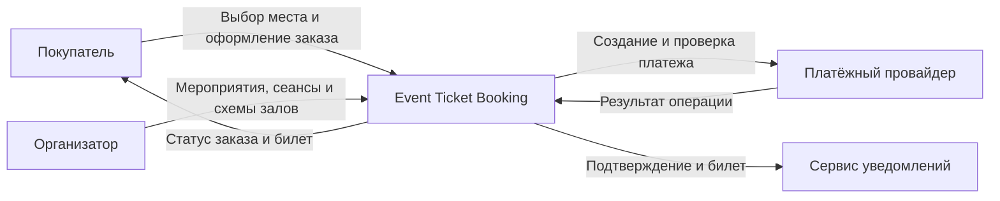

# Event Ticket Booking

Сервис бронирования билетов на мероприятия с выбором места.

Система управляет ограниченным ресурсом: одно место может быть доступно множеству покупателей, но продано только одному. Критический сценарий связывает временный резерв, заказ, внешнюю оплату и выпуск билета так, чтобы повторы запросов и частичные сбои не приводили к двойному бронированию или списанию.

## Ключевые инварианты

- у места может быть только один действующий резерв или подтверждённый билет;
- истёкший резерв нельзя подтвердить как успешную покупку;
- повтор запроса оплаты не создаёт повторное списание;
- билет выпускается только после подтверждённой оплаты;
- сбой уведомлений не отменяет оформленный заказ;
- неизвестный результат оплаты проверяется у провайдера без новой денежной операции.

## Системный контекст

Платёжный провайдер выполняет денежную операцию и принимает реквизиты карты. Система хранит только собственное состояние заказа, платёжной попытки и идентификатор операции провайдера.

## Архитектурный подход

Начальная форма системы — модульный монолит с явными предметными границами. Это позволяет сохранить простую эксплуатацию и строгую согласованность критических операций, не принимая стоимость распределённой системы до появления подтверждённых требований.

Границы модулей и кандидаты на независимое развёртывание будут уточняться через Event Storming, Context Map и сценарии качества. Решения фиксируются в ADR и пересматриваются при появлении новых архитектурных драйверов.

## Документация

- [Контекст и границы проекта](docs/project-context.md)
- [Архитектурные драйверы](docs/architecture-drivers.md)
- [Системный контекст](docs/system-context.md)
- [ADR-001: начать с модульного монолита](docs/adr/ADR-001-modular-monolith.md)

## Развитие проекта

Документация будет последовательно дополнена:

1. доменной моделью, единым языком и картой контекстов;
2. frontend-архитектурой и стратегией сборки и доставки;
3. контрактами API, моделями взаимодействия и идемпотентностью;
4. аутентификацией, авторизацией и инфраструктурным представлением;
5. тактиками отказоустойчивости, SLI/SLO и observability;
6. моделями хранения, кешированием и стратегией масштабирования.
