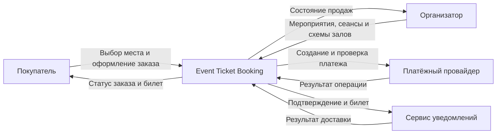

# Event Ticket Booking

Сервис бронирования билетов на мероприятия с выбором места.

Система управляет ограниченным ресурсом: одно место может быть доступно множеству покупателей, но продано только одному. Критический сценарий связывает временный резерв, заказ, внешнюю оплату и выпуск билета так, чтобы повторы запросов и частичные сбои не приводили к двойному бронированию или списанию.

## Ключевые инварианты

- у места может быть только один действующий резерв или подтверждённый билет;
- истёкший резерв нельзя подтвердить как успешную покупку;
- повтор запроса оплаты не создаёт повторное списание;
- билет выпускается только после подтверждённой оплаты;
- сбой уведомлений не отменяет оформленный заказ;
- неизвестный результат оплаты проверяется у провайдера без новой денежной операции.

## Системный контекст

Платёжный провайдер выполняет денежную операцию и принимает реквизиты карты. Система хранит только собственное состояние заказа, платёжной попытки и идентификатор операции провайдера.

## Архитектурный подход

Начальная форма системы — модульный монолит с явными предметными границами. Это позволяет сохранить простую эксплуатацию и строгую согласованность критических операций, не принимая стоимость распределённой системы до появления подтверждённых требований.

После моделирования определены Catalog, Booking, Payments и Notifications, каждый со своей приватной БД. Это логические сервисы внутри одной поставки backend; независимые деплои пока не требуются. Резерв, заказ и билет сохраняют одну атомарную границу Booking. Решения фиксируются в ADR и пересматриваются при появлении новых драйверов.

## Документация

- [Контекст и границы проекта](docs/project-context.md)
- [Архитектурные драйверы](docs/architecture-drivers.md)
- [Системный контекст](docs/system-context.md)
- [ADR-001: начать с модульного монолита](docs/adr/ADR-001-modular-monolith.md)
- [Единый язык](CONTEXT.md)
- [Учебные допущения](docs/assumptions.md)
- [Декомпозиция, Context Map и DIP](docs/domain-model.md)
- [Жизненный цикл покупки](docs/booking-lifecycle.md)
- [C4 Containers](docs/system-containers.md)
- [ADR-002: владение данными](docs/adr/ADR-002-domain-ownership.md)
- [Frontend-архитектура](docs/frontend-architecture.md)
- [Рендеринг, сборка и доставка](docs/delivery.md)

## Домашние задания

- [ДЗ 2: декомпозиция сквозного проекта](docs/homework/02-decomposition.md) — результат, критерии и пояснение.
- [ДЗ 3: фронт-архитектура проекта](docs/homework/03-frontend.md) — FSD, доставка, схема и три ADR.

Репозиторий содержит архитектурную документацию. Бюджеты и сценарии — цели проектирования; работающий backend/frontend и результаты его тестирования не заявляются.

## Развитие проекта

Документация будет последовательно дополнена:

1. контрактами API, моделями взаимодействия и идемпотентностью;
2. заданиями про надёжность, доступ и эксплуатацию по мере прохождения курса.
