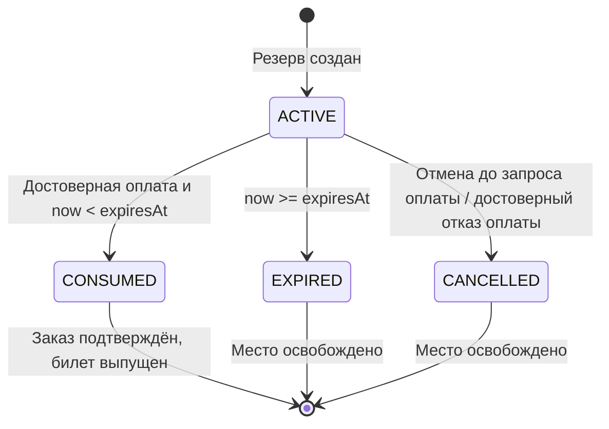

# Жизненный цикл бронирования и оплаты

Проектное поведение, общее для всех следующих ДЗ. Приложение не реализовано; сценарии ниже описаны для будущей приёмки, а не выполнены. Основание: [словарь](../CONTEXT.md), [границы и владельцы](domain-model.md), [допущения A-01–A-08](assumptions.md).

В первой версии один заказ относится к одному месту одного сеанса (A-01), резерв живёт 10 минут по времени БД (A-02). Сумма фиксируется при резервировании и переносится в заказ без перерасчёта. Срок не продлевается. Опубликованный снимок сеанса импортируется до открытия продаж; повторный импорт не обнуляет текущее состояние места.

## Состояния и владельцы

| Объект / владелец | Состояния | Существенное правило |
|---|---|---|
| Место / Booking | `AVAILABLE`, `HELD`, `SOLD` | Один авторитетный объект `(sessionId, seatId)`; держатель резерва известен |
| Резерв / Booking | `ACTIVE`, `CONSUMED`, `EXPIRED`, `CANCELLED` | Из терминального состояния нет возврата в `ACTIVE` |
| Заказ / Booking | `AWAITING_PAYMENT`, `CONFIRMED`, `EXPIRED`, `CANCELLED` | `CONFIRMED` означает оплату и приобретённое право на место |
| Платёжная попытка / Payments | `CREATED`, `PENDING`, `UNKNOWN`, `SUCCEEDED`, `FAILED` | Одна попытка на заказ; `UNKNOWN` не разрешает новую операцию |
| Возврат / Payments | `REQUIRED`, `PENDING`, `REFUNDED`, `REVIEW_REQUIRED` | Отдельная операция; факт `SUCCEEDED` исходной оплаты сохраняется |
| Билет / Booking | Выпущен либо отсутствует | Один билет на подтверждённый заказ; сохраняется при ошибке уведомления |
| Доставка / Notifications | Ожидает, доставлена, требует повторения/разбора | Не меняет состояние покупки |

Ни `SUCCEEDED` платежа, ни экран провайдера сами по себе не означают `CONFIRMED` заказа. Достоверный `FAILED` — отказ без неизвестного денежного эффекта. Если внешний вызов мог выполниться, его результат остаётся `UNKNOWN` до сверки. Если новая операция не успела начаться до срока, это `FAILED` с причиной `reservation_expired_before_submit`, а не неизвестный результат.

## Атомарная граница Booking

Резервирование сериализует доступ к авторитетному месту. В первой версии одна транзакция Booking создаёт и резерв, и заказ: при конкуренции только один покупатель получает `HELD`, новый резерв и заказ с зафиксированной суммой. Отдельного промежуточного резерва без заказа нет. Истёкший прежний резерв допускается завершить внутри той же транзакции перед новым резервированием.

Освобождение всегда проверяет `heldByReservationId`: таймер, отмена и поздний результат старого заказа не могут освободить место, уже удерживаемое новым резервом или проданное другому покупателю.

Во всех переходах, затрагивающих срок, сервер читает **свежее время БД после получения нужных блокировок**, непосредственно при проверке условия. Время старта транзакции, время браузера и момент начала ожидания блокировки не подходят. Иначе ожидавший запрос мог бы использовать уже истёкшее право.

Подтверждение покупки по достоверному результату оплаты проверяет одновременно:

1. `orderId`, `paymentRequestId`, `paymentAttemptId`, сумма и валюта относятся к этой покупке и к одному сохранённому намерению.
2. Заказ ожидает оплату, резерв активен, место удерживает именно этот резерв.
3. Свежее серверное время строго меньше `expiresAt`.

В одной транзакции **только booking_db** фиксируются inbox сообщения, `CONFIRMED` заказа, `CONSUMED` резерва, `SOLD` места, уникальный билет и outbox для уведомления. Повтор уже применённого сообщения возвращает известный результат. Отдельные сообщения с тем же денежным фактом тоже не создают второй билет: защищены идентификатор попытки, терминальные состояния и уникальность билета.

Если срок уже наступил, но фоновая очистка ещё не перевела резерв из `ACTIVE`, обработчик успеха сам завершает резерв и заказ как `EXPIRED`. В той же транзакции он освобождает место только при совпадении `heldByReservationId`, фиксирует inbox и outbox возврата. Если заказ ранее истёк или отменён, обработчик сохраняет только ещё необходимый результат обработки и единственное задание возврата. Билет не создаётся. Неизвестная ссылка на заказ или несовпадение суммы не трактуется как успешная покупка: сообщение сохраняется для разбора, переход отклоняется.

## Гонка оплаты и истечения

Обработчики подтверждения и истечения используют одну границу сериализации Booking. Правило срока проверяется при переходе после блокировки; неважно, какой обработчик начал работу раньше. На самой границе `now = expiresAt` резерв уже недействителен. При любом исходе максимум одно действующее право на место.

Фоновая очистка должна освободить место не позднее 30 секунд после `expiresAt` (Q-03, учебная цель). Эта задержка **не даёт дополнительных 30 секунд на подтверждение**. Если фоновой задачи ещё не было, входящий запрос всё равно проверяет срок. Резерв и задачи сохраняются в БД; перезапуск процесса не создаёт новый TTL и не теряет необходимость освобождения.

Поздний успех не возрождает истёкший резерв, даже когда провайдер сообщает более ранний `occurredAt`: к моменту достоверного подтверждения место могло перейти другому покупателю. По A-06 запускается возврат; если автоматически завершить его нельзя, сохраняется `REVIEW_REQUIRED`. Это консервативный выбор: платим возможными возвратами при задержанном подтверждении за исключение двойного билета. В интерфейсе различаются «покупка подтверждена» и «деньги получены, покупка не состоялась, возврат обрабатывается».

Покупатель может отменить заказ только до сохранения запроса оплаты. Отмена и приём запроса оплаты сериализуются в Booking: если отмена победила, запрос оплаты отклоняется; если запрос уже сохранён, пользовательская отмена недоступна. Достоверный `FAILED` от Payments позволяет Booking идемпотентно отменить ещё ожидающий заказ, завершить резерв и освободить его место. Такой результат не откатывает уже подтверждённую покупку и не изменяет чужой новый резерв.

## Одна попытка, неизвестность и денежные повторы

Booking сначала сохраняет единственное на заказ намерение начать оплату с `orderId`, зафиксированными суммой/валютой и `expiresAt` вместе с outbox. HTTP-ответ подтверждает приём намерения, а не наличие платёжной попытки или банковский успех. Worker доставляет задание Payments; тот принимает его идемпотентно и сохраняет единственную попытку на заказ. Новый HTTP-ключ, двойное нажатие или повтор задания не создают вторую попытку.

Перед первым внешним созданием Payments проверяет, что срок ещё не истёк. Задание, задержавшееся до истечения резерва, не начинает новое списание. После отправки запроса неизвестный ответ не равен отсутствию операции: дальнейшая работа использует тот же reference, а не новый платёж.

Гарантия отсутствия второго внешнего списания зависит от A-05: идемпотентность провайдера не менее 24 часов и поиск по стабильному reference. Внутренняя привязка заказа, попытки и reference сохраняется на время жизни процесса, включая неопределённость и возврат. После окончания окна гарантии запрещён слепой повтор создания; допускается поиск/сверка, при невозможности — разбор. Inbox сам по себе не защищает внешние денежные эффекты.

В этой версии достоверно отклонённая единственная попытка не заменяется другой в том же заказе. После обработки отказа Booking отменяет старую покупку; покупатель может начать новый резерв/заказ. Это ограничение первой модели, а не свойство любого платёжного продукта.

Подлинность callback проверяется в Payments до принятия денежного факта; сверка идёт через доверенный API провайдера. Старое `PENDING` не перезаписывает `SUCCEEDED`, а противоречивый результат требует сверки. Версия внутреннего состояния отличается от версии схемы сообщения и от внешнего времени события.

## Восстановление между четырьмя БД

| Переход | Что сохраняется до подтверждения | Что делает повтор |
|---|---|---|
| Booking → Payments: начать оплату | Booking outbox; затем Payments inbox + единственная попытка + задание провайдеру | Возвращает ту же попытку по заказу |
| Провайдер → Payments: результат | Достоверный денежный факт и Payments outbox в одной локальной транзакции | Не стирает и не размножает факт |
| Payments → Booking: успех | Booking inbox + результат покупки/задание возврата + outbox в одной локальной транзакции | Не выпускает второй билет и не оживляет резерв |
| Booking → Payments: вернуть деньги | Payments inbox + единственное задание возврата | Продолжает существующий возврат с тем же reference |
| Booking → Notifications: подтвердить покупку | Notifications inbox + задание доставки | Не создаёт второе логическое уведомление; внешний повтор зависит от возможностей доставки |

Отправитель помечает outbox доставленным только после подтверждения commit получателя. Падение после commit, но до ACK вызывает повтор, который распознаётся получателем. Никакой общей транзакции между базами или с провайдером нет. Состояние возврата восстанавливается так же, как оплата: таймаут не считается доказательством неисполнения.

Безопасный повтор внешнего возврата также зависит от возможностей провайдера: нужны идемпотентный reference возврата и поиск его результата (A-05). Если эти гарантии отсутствуют либо закончились, неизвестный возврат переводится в `REVIEW_REQUIRED`; новый автоматический возврат не запускается. Локальное уникальное задание не доказывает единственность внешнего эффекта.

## Сценарии будущей приёмки

Это проверки согласованности проекта и требования к будущей реализации. **Ни один пункт не обозначает уже пройденный тест приложения.**

| Сценарий | Ожидаемый результат | Связь |
|---|---|---|
| Два покупателя одновременно резервируют одно место | Один резерв; второй получает однозначный отказ | Q-01 |
| Запрос ждал блокировку до окончания TTL | Проверяет свежее время после блокировки; старое право не подтверждает | Q-01, Q-03 |
| Два запроса оплаты с одним либо разными HTTP-ключами для одного заказа | Одна платёжная попытка и одна логическая денежная операция | Q-02 |
| Провайдер принял оплату, ответ потерян | `UNKNOWN`, затем сверка того же reference; новое списание не создаётся | Q-02, Q-04 |
| Задание начать оплату обработано после `expiresAt` | Первый внешний create не выполняется | Q-02, Q-03 |
| Callback продублирован; затем пришёл старый `PENDING` | Один денежный факт, один билет при допустимом резерве; состояние не откатывается | Q-01, Q-02 |
| Payments сохранил успех и упал до доставки Booking | Outbox восстанавливает доставку; Booking повторно проверяет срок | Q-04 |
| Booking сделал commit покупки и упал до ACK | Повтор распознан; второй билет и outbox уведомления не создаются | Q-01, Q-02, Q-04 |
| Успех и истечение конкурируют на границе срока | Один сериализованный исход; `now >= expiresAt` запрещает подтверждение | Q-01, Q-03 |
| Успех пришёл после срока, но резерв ещё `ACTIVE` до очистки | Одна Booking-транзакция завершает заказ/резерв, освобождает только его место и сохраняет возврат | Q-01, Q-03, Q-04 |
| Успех пришёл после истечения, место уже продано другому | Первый заказ остаётся истёкшим; сохраняется возврат, второй билет не появляется | Q-01, Q-04 |
| Старый таймер пришёл после выдачи нового резерва на то же место | `heldByReservationId` не совпадает; новый резерв остаётся действующим | Q-01, Q-03 |
| Отмена покупателя конкурирует с приёмом запроса оплаты | Один из переходов принят; после сохранения запроса пользовательская отмена недоступна | Q-01, Q-02 |
| Payments доставил достоверный отказ повторно | Booking один раз отменяет ожидающий заказ и освобождает только его место | Q-01, Q-02 |
| Процесс упал после внешнего возврата, до записи результата | При гарантиях A-05 — сверка/тот же reference; без них — `REVIEW_REQUIRED`, без нового автоматического возврата | Q-02, Q-04 |
| Ошибка доставки уведомления | Заказ и билет сохранены и доступны владельцу | Q-04, Q-07 |
| Повторный/старый снимок Catalog пришёл после продажи | Право на место и зафиксированная сумма заказа не сбрасываются | Q-01 |
| Покупатель запросил чужой заказ или билет | Booking проверил владельца и отказал, независимо от кеша и входного слоя | Q-07 |

Ограничения по отказам инфраструктуры, числам нагрузки и времени восстановления оцениваются по [допущениям](assumptions.md) и сценариям качества. Здесь не заявляется гарантия срока освобождения или возврата при произвольной длительной недоступности БД/провайдера.
