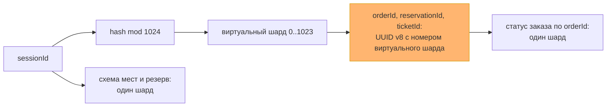
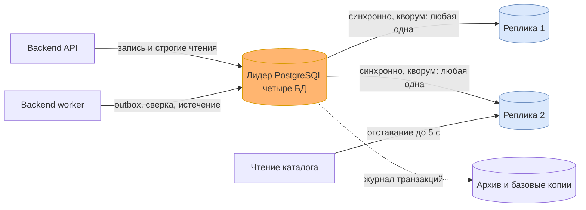

# Данные и масштабирование: хранилища, шарды и реплики

Первая половина итогового проекта — решение по данным, шаги 1–3 задания урока 24. Вторая половина, сборка всего проекта в одно решение, лежит в [итоговом решении](final-solution.md).

Наборы данных не выдумываются заново: это данные четырёх владельцев из [доменной модели](domain-model.md#карта-логических-сервисов-и-владения-данными), строгость — из [жизненного цикла покупки](booking-lifecycle.md), кеши — из [frontend-архитектуры](frontend-architecture.md#кеширование-и-приватность). Нагрузка — по [A-03](assumptions.md), объём за год — по новому допущению A-08: 20 000 сеансов в год, в среднем 800 мест на сеанс, около 3 млн проданных билетов и 5 млн созданных заказов, часть которых истекает или отменяется. Это учебные условия, а не прогноз продаж; проверяются так же, как A-03.

## Шаг 1. Наборы данных: хранилище, согласованность, кеш

Строгие наборы — те, где расхождение копий означает чужое место, второе списание или потерянную покупку. Терпимые — те, где старая копия лишь показывает прошлое и ничего не разрешает.

| Набор | Владелец и хранилище | Согласованность | Кеш | Как растёт |
|---|---|---|---|---|
| **N1. Места сеанса и их доступность** | Booking, `booking_db` | Строгая, ACID: переход места сериализуется | HTTP-кеша нет; UI держит подсказку 5 с, право проверяет Booking | ~16 млн строк в год: места каждого сеанса |
| **N2. Резерв, заказ, билет** | Booking, `booking_db` | Строгая, ACID: одна локальная транзакция | Нет: `private, no-store` | ~13 млн строк в год: 5 млн резервов и заказов, 3 млн билетов |
| **N3. Ключи идемпотентности, inbox и outbox Booking** | Booking, `booking_db` | Строгая, ACID: фиксируются вместе с эффектом | Никогда: промах кеша означал бы дубль | ~25 млн строк в год, хранятся на срок жизни заказа |
| **N4. Платёжные попытки, денежные факты, возвраты** | Payments, `payments_db` | Строгая, ACID; внешний результат сверяется с провайдером | Нет | ~4 млн попыток и фактов, ~10 млн строк inbox/outbox в год |
| **N5. Каталог: мероприятия, сеансы, схемы залов** | Catalog, `catalog_db` | Терпимая: окно 60 с кеша плюс до 5 с отставания реплики | Reverse proxy, `s-maxage=60`, без purge | Менее 1 млн строк в год |
| **N6. Задания и попытки доставки уведомлений** | Notifications, `notifications_db` | Терпимая: статус доставки может отставать на минуты | Нет | ~6 млн строк в год |

Растут три набора: N1–N3 в Booking, всего около 55 млн строк и порядка 30–40 ГБ с индексами в год. Payments и Notifications вместе — ещё порядка 10 ГБ. Каталог мал.

**Серверный кеш (упражнение урока 23).** Отдельного кеш-сервера в первой версии нет, и это решение, а не пропуск. Единственный набор, который читают намного чаще, чем меняют, — публичный каталог, и его уже закрывает кеш proxy на 60 с. Остальное либо строгое, либо читается владельцем: кеш над N2–N4 нарушил бы read-your-writes, а N3 закеширован быть не может вообще. Защита от stampede нужна именно у кеша каталога: когда запись истекает на популярном сеансе, proxy пропускает к Catalog **один** запрос за ключ, остальные ждут его ответа, а не идут в origin толпой. Серверный кеш появится, если после кеша proxy p95 чтения каталога выйдет за бюджет API или чтения каталога станут заметной долей нагрузки на лидера.

## Шаг 2. Шардировать или нет

Решение принимается для каждого набора отдельно. Каталог, Payments и Notifications малы и шарды им не нужны ни сейчас, ни при десятикратном росте. Вопрос сводится к Booking — N1–N3.

Прохожу лестницу из урока снизу вверх.

| Ступень | Что упирается в Booking | Хватает? |
|---|---|---|
| Индексы | Схема мест по `sessionId`, место по `(sessionId, seatId)`, заказ по `orderId`, ключ по области и хешу | Да, все главные запросы идут по индексу |
| Кеш | Чтение схемы мест на пике | Да, частично: подсказка доступности в UI; кеш над строгими данными не ставим |
| Реплики чтения | Booking читает только с лидера — см. шаг 3 | Не применимо: реплики нужны для доступности, не для чтения |
| Мощнее узел | Запись в пик | Не понадобился: см. расчёт ниже |
| Шарды | Запись и объём | Нет необходимости |

Пиковая запись по A-03 — 50 изменений в секунду. Одна команда резервирования пишет около пяти строк: место, резерв, заказ, ключ и ответ; вместе с outbox и оплатой это порядка 300–500 записей в секунду. Одна база PostgreSQL на обычном сервере держит такой поток с запасом на порядок; это проверяется нагрузочной проверкой A-03 до выпуска, а не принимается на веру. Объём — 30–40 ГБ в год — тоже в пределах одного узла.

**Решение: шарды не вводим.** Они добавили бы издержки без выгоды: отчёт организатора по продажам превратился бы в обход всех шардов, миграции шли бы на каждом узле, резервное копирование и восстановление умножились бы на число узлов.

**Горячее место шардирование не лечит.** Всплеск из A-03 — 100 покупателей на одно место — это одна строка `(sessionId, seatId)` в Booking. Шард делит строки между узлами, а здесь вся нагрузка на одну строку, и она останется на одном узле при любом числе шардов. Работают другие меры, которые уже приняты: короткая транзакция без внешних вызовов, ожидание блокировки в пределах доли бюджета 1 200 мс и штатный доменный отказ проигравшим, без автоматических повторов.

**Объём закрывается архивом, а не шардами.** Первый шаг по таблице урока — архив старых данных по дате. Сеанс, который прошёл больше года назад, больше не продаёт: его места и завершённые заказы переносятся в архивную секцию одной операцией. Ключи и ссылки денежных операций при этом сохраняются, пока не завершено урегулирование: удаление старого payload не должно открыть повторную оплату.

**Сигнал к пересмотру — числом.** Шарды возвращаются в повестку, если выполнится любое из двух:
- пиковая запись устойчиво выше 500 изменений в секунду, то есть вдесятеро выше A-03, и вертикальный рост уже исчерпан;
- горячие данные `booking_db` без архива превысили 500 ГБ.

Обе величины видны на [дашборде](observability-plan.md#эскиз-дашборда): поток команд Booking и размер БД.

**Ключ на будущее выбран сейчас.** Главные запросы к Booking:
1. схема мест и доступность сеанса — по `sessionId`;
2. резерв места — по `(sessionId, seatId)`;
3. статус заказа — по `orderId`, самый частый: видимая вкладка опрашивает его каждые 4–6 секунд.

Ключ — `sessionId`. Только он держит в одном шарде место, его резерв, заказ, билет и ключи команды, и покупка остаётся одной локальной транзакцией, без кросс-шардовой фиксации. Шардировать по `buyerId` нельзя: тогда два покупателя одного места оказались бы в разных шардах, и исключительность места пришлось бы обеспечивать распределённой транзакцией.

Но третий запрос по случайному UUID заказа ушёл бы во все шарды — это scatter-gather на самом частом чтении. Поэтому идентификаторы `orderId`, `reservationId` и `ticketId` начинают нести номер виртуального шарда, вычисленный из `sessionId`. Формат в контрактах не меняется: это по-прежнему UUID, только версии 8, где 10 бит отведены под `hash(sessionId) mod 1024`. Решение записано в [ADR-007](adr/ADR-007-data-single-cluster-shard-ready-ids.md).

Цена ключа по сеансу видна заранее. Популярный концерт — это горячий сеанс, и все его покупки лягут в один шард: перекос по горячему ключу из урока. Поэтому карта шардов с первого дня допускает исключение «сеанс → выделенный узел», то есть стратегию directory поверх hash. Запрос «мои заказы» по `buyerId` при шардах обходил бы все узлы; он редкий, и при шардировании для него заводится проекция по покупателю — витрина, как у отчётов.

## Шаг 3. Репликация и карта шардов

**Сколько можно потерять после commit.** Для Booking и Payments — ноль. Потерянный после commit резерв означает, что место продадут второй раз; потерянный денежный факт — что деньги списаны, а покупки нет. Это нарушение инвариантов, а не деградация, поэтому реплика для них синхронная.

Физическая репликация PostgreSQL работает на весь кластер, а не на отдельную БД. Все четыре базы A-07 живут в одном кластере, поэтому получают одну и ту же гарантию — самую строгую, нужную деньгам и праву на место. Для каталога и уведомлений это запас, а не цена: их объём мал.

| Набор | Пишем | Читаем | Почему |
|---|---|---|---|
| N1–N3, Booking | Лидер | Только лидер | Статус сразу после оплаты, право на место и ключи требуют read-your-writes; реплика могла бы показать прошлый статус |
| N4, Payments | Лидер | Только лидер | Денежный факт и сверка не допускают старой копии |
| N5, каталог | Лидер | Реплика с отставанием до 5 с, дальше кеш proxy | Окно публичной устарелости становится 60 с кеша плюс до 5 с реплики; при отставании больше 5 с чтение каталога возвращается на лидера |
| N6, уведомления | Лидер | Лидер | Набор мал; статус доставки для UI читается через порт Notifications, отдельная копия не нужна |

**Схема: лидер и две реплики с кворумом.** Commit подтверждается, когда изменение легло на лидера и хотя бы на одну из двух реплик — синхронная репликация с кворумом «любая одна из двух». Отказ любого одного узла не теряет подтверждённых данных, а отказ одной реплики не останавливает запись: кворум держит вторая.

- **Отказ лидера** закрывается автоматическим переключением на самую свежую реплику; цель — до 60 секунд. В это время proxy отдаёт `503` с `Retry-After`, как при выкате, а клиенты продолжают прежние операции по своим ключам. Ответ, потерянный на COMMIT в момент отказа, обрабатывается как любой неизвестный результат: перечитать и повторить ту же команду.
- **Отказ обеих реплик** останавливает запись Booking и Payments. Это осознанный выбор того же [главного компромисса](architecture-drivers.md#главный-компромисс): корректность права и денег важнее доступности подтверждения. Сигнал об этом — срочный.
- **Цена:** три узла вместо одного и задержка commit на сетевой круг до ближайшей реплики — в пределах одного ЦОД это единицы миллисекунд внутри доли бюджета 1 200 мс.

**Реплики не защищают от логической ошибки.** Ошибочная миграция или `DELETE` честно уедут на все копии. Поэтому отдельно: ежедневная базовая копия и непрерывный архив журнала транзакций с восстановлением на момент времени. Потеря при такой ошибке — до последнего архивированного сегмента, порядка минуты; восстановление репетируется раз в квартал, иначе цифра ничего не значит.

**Карта шардов — в клиенте.** Сегодня шард один, и карты нет, но место выбрано заранее. Каждой БД владеет один модуль, а API и worker собираются [из одного артефакта](adr/ADR-001-modular-monolith.md): главный минус клиентской карты — рассинхрон версий у разных потребителей — у нас не возникает, новая карта выкатывается обоими процессами одновременно. Координатор или прокси добавили бы узел на пути каждого запроса, а выигрывать им нечего. Карта — это таблица «виртуальный шард → узел» плюс исключения «горячий сеанс → выделенный узел»; сегодня все 1024 виртуальных шарда отображаются на один кластер.

Пул соединений к реплике доступен только модулю чтения каталога. Booking, Payments и обработчики outbox о нём не знают, и случайно отправить туда проверку резерва или ключа нельзя.

## Что задание поймало в уже принятых решениях

**Случайный `orderId` закрывал дорогу к шардам.** Самое частое чтение системы — опрос статуса заказа — при шардировании по сеансу ушло бы во все шарды. Поменять формат идентификатора сейчас стоит нескольких бит, потом — миграции всех заказов, ссылок в событиях и сохранённых в браузерах маршрутов. Отсюда [ADR-007](adr/ADR-007-data-single-cluster-shard-ready-ids.md).

**«Четыре приватные БД» не означают четыре режима надёжности.** A-07 разделил владение данными, но физическая репликация общая на кластер. Требование самого строгого набора — денег — автоматически применяется ко всем четырём. Это стоит понимать, прежде чем ослаблять гарантию «для дешёвого каталога».

**Отказ базы в тактиках заканчивался ожиданием.** В [таблице сбоев](reliability.md#тип-сбоя-и-первая-тактика) строка про PostgreSQL сводилась к «прекратить переходы и ждать», а RPO/RTO были записаны как открытый риск. Теперь у отказа лидера есть тактика — переключение на синхронную реплику — и числа: потеря ноль, переключение до 60 секунд. Строка и абзац в тактиках обновлены.

**Срок резерва переживает смену лидера.** Правило `now < expiresAt` проверяется по часам БД. После переключения часы — уже другого узла, поэтому синхронизация времени на узлах кластера становится требованием, а не мелочью: расхождение часов на секунды сдвинуло бы границу резерва.

## Как это читать на проверке

Отказ от шардов здесь — результат, а не пропуск: лестница остановилась на одном узле, сигнал к пересмотру записан двумя числами, ключ на будущее выбран и уже отражён в формате идентификаторов. Репликация выбрана от допустимой потери, а не от моды: ноль для денег и права на место даёт синхронный кворум, а цену — остановку записи при потере обеих реплик — система платит сознательно.
