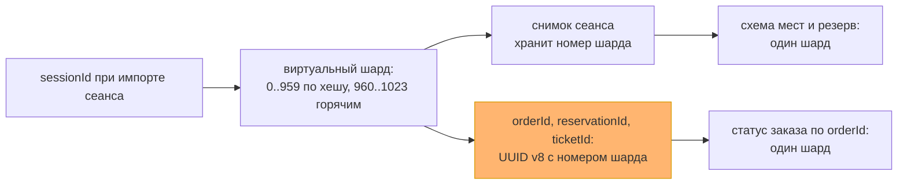
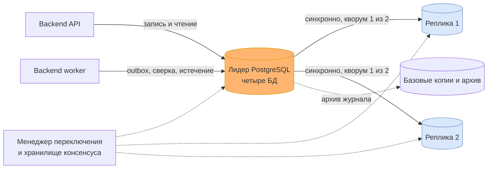

# Данные и масштабирование: хранилища, шарды и реплики

Первая половина итогового проекта — решение по данным, шаги 1–3 задания урока 24. Вторая половина, сборка всего проекта в одно решение, лежит в [итоговом решении](final-solution.md).

Наборы данных взяты из прежних работ: владельцы — из [доменной модели](domain-model.md#карта-логических-сервисов-и-владения-данными), строгость — из [жизненного цикла покупки](booking-lifecycle.md), кеши — из [frontend-архитектуры](frontend-architecture.md#кеширование-и-приватность). Пиковая нагрузка — по [A-03](assumptions.md): 1 000 активных посетителей и до 50 команд изменения в секунду. Объём за год — по новому допущению A-08: 20 000 сеансов, в среднем 300 мест на сеанс, около 3 млн проданных билетов, то есть половина мест, и 5 млн созданных заказов, часть которых истекает или отменяется. Это учебные условия, а не прогноз продаж; проверяются так же, как A-03.

## Шаг 1. Наборы данных: хранилище, согласованность, кеш

Строгие наборы — те, где расхождение копий означает чужое место, второе списание или потерянную покупку. Терпимые — те, где старая копия лишь показывает прошлое и ничего не разрешает.

| Набор | Владелец и хранилище | Согласованность | Кеш-стратегия | Как растёт |
|---|---|---|---|---|
| **N1. Места сеанса и их доступность** | Booking, `booking_db` | Строгая, ACID: переход места сериализуется | На сервере не кешируется. UI держит подсказку до 5 с; право проверяет Booking | ~6 млн строк в год: места каждого сеанса |
| **N2. Резерв, заказ, намерение оплаты, билет** | Booking, `booking_db` | Строгая, ACID: одна локальная транзакция | Не кешируется: `private, no-store` | ~16 млн строк в год: по 5 млн резервов и заказов, ~3,5 млн намерений, 3 млн билетов |
| **N3. Ключи идемпотентности, inbox и outbox Booking** | Booking, `booking_db` | Строгая, ACID: фиксируются вместе с эффектом | Не кешируется никогда: устаревшая копия «ключа нет» означала бы дубль | ~25 млн строк в год |
| **N4. Платёжные попытки, денежные факты, возвраты** | Payments, `payments_db` | Строгая, ACID; внешний результат сверяется с провайдером | Не кешируется | ~6 млн строк попыток и фактов, ~10 млн строк inbox/outbox в год |
| **N5. Каталог: мероприятия, сеансы, схемы залов** | Catalog, `catalog_db` | Терпимая: окно публичной устарелости 60 с | Read-through в reverse proxy: `s-maxage=60`, без purge, один запрос к origin на ключ | Менее 1 млн строк в год |
| **N6. Задания и попытки доставки уведомлений** | Notifications, `notifications_db` | Терпимая: статус доставки может отставать на минуты | Не кешируется | ~6 млн строк в год |

Быстрее всего растёт Booking: N1–N3 — около 47 млн строк и порядка 25–35 ГБ с индексами в год. Payments и Notifications вместе — ещё порядка 10 ГБ. Каталог мал.

**Серверный кеш (урок 23).** Кеша в приложении и отдельного кеш-сервера в первой версии нет. Единственный набор, который читают намного чаще, чем меняют, — публичный каталог, и его закрывает HTTP-кеш proxy на 60 с. Остальное либо строгое, либо читается владельцем: кеш над N2–N4 нарушил бы read-your-writes, а N3 кешировать нельзя вообще. Защита от stampede нужна именно у кеша каталога: когда запись популярного сеанса истекает, proxy пропускает к Catalog один запрос за ключ, остальные ждут его ответа. Это добавлено в [договорённости по кешу](frontend-architecture.md#кеширование-и-приватность). Кеш в приложении появится, если промахи кеша proxy начнут давать лидеру больше 100 чтений каталога в секунду.

## Шаг 2. Шардировать или нет

Решение принимается для каждого набора отдельно. Каталог, Payments и Notifications малы, шарды им не нужны и при десятикратном росте. Вопрос сводится к Booking — N1–N3.

Лестница из урока снизу вверх:

| Ступень | Что упирается в Booking | Хватает? |
|---|---|---|
| Индексы | Схема мест по `sessionId`, место по `(sessionId, seatId)`, заказ по `orderId`, ключ по области и хешу | Да, все главные запросы идут по индексу |
| Кеш | Чтение схемы мест на пике | Частично: подсказка доступности в UI; кеш над строгими данными не ставим |
| Реплики чтения | Опрос статуса и схемы мест | Не нужны: около 200 чтений статуса в секунду — точечные чтения по индексу, лидер их держит |
| Мощнее узел | Запись в пик | Не понадобился, см. расчёт ниже |
| Архив по дате | Объём | Да: прошедшие сеансы уходят в архивную секцию |
| Шарды | Запись и объём | Нет необходимости |

Чтение: 1 000 посетителей, опрашивающих статус раз в 5 секунд, дают около 200 точечных чтений в секунду, плюс чтение схемы мест при открытии сеанса и после команды. Запись: команда резервирования пишет около пяти строк — место, резерв, заказ, ключ и сохранённый ответ; вместе с outbox и оплатой это порядка 300–500 записей строк в секунду на пике. Одна база PostgreSQL на обычном сервере держит такой поток с запасом на порядок. Это проверяется нагрузочной проверкой A-03 до выпуска. Объём — 25–35 ГБ в год — тоже в пределах одного узла.

**Решение: шарды не вводим.** Они добавили бы издержки без выгоды: отчёт организатора по продажам обходил бы все шарды, миграции шли бы на каждом узле, резервные копии и восстановление умножились бы на число узлов.

**Горячее место шардирование не лечит.** Всплеск из A-03 — 100 покупателей на одно место — это одна строка `(sessionId, seatId)`. Шард делит строки между узлами, а здесь вся нагрузка на одну строку, и она останется на одном узле при любом числе шардов. Работают уже принятые меры: короткая транзакция без внешних вызовов, ожидание блокировки в пределах доли бюджета 1 200 мс, штатный доменный отказ проигравшим без автоматических повторов.

**Объём закрывается архивом.** Сеанс, прошедший больше года назад, больше не продаёт: payload его мест, завершённых заказов и их inbox/outbox переносится в архивную секцию. Ключ команды, её отпечаток и уникальность намерения по `orderId` остаются в горячей таблице бессрочно: [идентификаторы заказов не переиспользуются](interaction-model.md#повторы-ключи-и-хранение), и поздний replay не должен открыть повторную оплату.

**Сигнал к пересмотру — числом.** Шарды возвращаются в повестку, если выполнится любое из двух:
- пик устойчиво выше 500 команд изменения в секунду, то есть вдесятеро выше A-03, и вертикальный рост уже исчерпан;
- горячие секции `booking_db`, без архивных, превысили 500 ГБ.

Обе величины выведены на [дашборд](observability-plan.md#эскиз-дашборда).

**Ключ на будущее выбран сейчас.** Главные запросы к Booking:
1. схема мест и доступность сеанса — по `sessionId`;
2. резерв места — по `(sessionId, seatId)`;
3. статус заказа — по `orderId`, самый частый: видимая вкладка опрашивает его каждые 4–6 секунд.

Ключ — `sessionId`. Пока в заказе одно место (A-01), покупку в одном шарде удержал бы и `(sessionId, seatId)`. Но тогда схема мест сеанса — первый запрос — читалась бы со всех шардов, а будущая корзина из нескольких мест одного сеанса потребовала бы кросс-шардовой транзакции. Ключ по сеансу держит вместе всё место-ориентированное: схему, резервы, заказы, билеты и ключи команды резервирования. Шардировать по `buyerId` нельзя: два покупателя одного места оказались бы в разных шардах, и исключительность места потребовала бы распределённой транзакции.

Третий запрос по случайному UUID заказа ушёл бы во все шарды — scatter-gather на самом частом чтении. Поэтому `orderId`, `reservationId` и `ticketId` несут номер виртуального шарда. Номер назначается сеансу один раз, при импорте его снимка в Booking, и хранится в этом снимке:
- обычный сеанс получает `hash(sessionId) mod 960` — номера 0..959;
- заранее известный горячий сеанс получает свободный номер из резерва 960..1023, который потом можно увезти на выделенный узел целиком.

Снимки сеансов — маленькая справочная таблица: 20 000 строк в год. При шардировании она копируется на каждый шард, поэтому маршрут вычисляется и по `sessionId`, и по `orderId`. В контрактах идентификаторы остаются UUID, только версии 8 вместо 4. Подробности — в [ADR-007](adr/ADR-007-data-single-cluster-shard-ready-ids.md).

Ключи команд при шардировании. Область ключа оплаты дополняется `orderId`, и он ищется в шарде заказа; проверка «тот же ключ применён к другому заказу» при этом перестаёт работать. Область ключа `reserveSeat` дополняется `sessionId`, и конфликт «тот же `clientKey` с другим сеансом» тоже перестаёт обнаруживаться. Обе потери допустимы: клиент генерирует новый ключ на каждую команду и повторяет только ту же самую, а единственность оплаты держит уникальность намерения по `orderId`.

Запросы без ключа сеанса — «мои заказы» по `buyerId`, отчёт по мероприятию из многих сеансов, обход outbox и истечения в worker — при шардах обходили бы все узлы. Для первых двух заводится проекция, worker обходит шарды по очереди.

## Шаг 3. Репликация и карта шардов

**Сколько можно потерять после commit.** Для Booking и Payments — ноль. Потерянный после commit резерв означает, что место продадут второй раз; потерянный денежный факт — что деньги списаны, а покупки нет. Для каталога и уведомлений потеря тоже нежелательна, хотя сами данные терпимые: асинхронный commit, за которым не последовало синхронного, мог бы пропасть при отказе лидера — например, подтверждённая организатору публикация или отметка о доставке уведомления. Цепочку outbox общий кластер при этом защищает сам: у всех четырёх баз один журнал транзакций в порядке commit, и подтверждённый репликой синхронный commit отправителя означает, что на реплике есть и более ранний commit получателя. Поэтому синхронный кворум задан для всех баз: потеря после commit — ноль везде, а настройка одна. Если базы когда-нибудь разъедутся по разным кластерам, порядка журнала между ними не будет, и для outbox это станет обязательным, а не удобным.

**Схема: лидер и две реплики с синхронным кворумом на весь кластер.** Commit подтверждается, когда изменение легло на лидера и хотя бы на одну из двух реплик. Кворум «любая одна из двух» выставляет менеджер переключения (см. ниже); `synchronous_commit = on` задан для кластера, и приложение его не меняет — это проверяется ревью кода и мониторингом настроек сессий. Отказ любого одного узла не теряет подтверждённых данных, отказ одной реплики не останавливает запись.

Все базы пишут и читают только лидера. Реплики в первой версии нужны для доступности, а не для чтения: чтение не упирается, а строгие данные требуют read-your-writes — статус заказа сразу после оплаты с реплики показал бы прошлое. Если чтение каталога станет нагрузкой на лидера, первым шагом появится кеш в приложении (см. шаг 1). Если и его не хватит, анонимные GET каталога уйдут на реплику с порогом отставания, а `s-maxage` уменьшится на это отставание, чтобы окно 60 с не выросло.

**Как ведёт себя commit.** Пока транзакция ждёт реплику, другие сессии её не видят, а её блокировки держатся. Опасен только случай, когда ожидание прервано: отменой, таймаутом оператора, обрывом соединения или перезапуском лидера без переключения. Тогда commit становится видимым и подтверждённым на лидере, но, возможно, не на реплике.
- Для транзакций команд `statement_timeout` не задаётся: в PostgreSQL он действует и на COMMIT и прерывает ожидание реплики. Долю бюджета 1 200 мс держит `lock_timeout` на ожидание блокировки места; ни драйвер, ни администратор не отменяют COMMIT. Если ответ не успел в дедлайн API, клиент получает `503`, а commit продолжает ждать реплику.
- Повтор команды по ключу, нашедший сохранённый ответ, подтверждает его пишущей транзакцией, то есть сам ждёт кворум. Так клиент не получит успех, которого нет на реплике, даже если ожидание первого commit было прервано.
- Если такой прерванный commit увидел worker и передал задание в Payments, commit Payments пишется в журнал позже и, подтвердившись репликой, тянет туда и commit Booking. Обе записи пропадают при смене лидера, только если прервано и ожидание commit Payments, а внешний create уже ушёл. Тогда денежный факт с неизвестным reference идёт по существующему правилу — в разбор, без автоматического подтверждения.

**Пустой кворум.** Если пропадут обе реплики, commit во всех базах не падает, а ждёт. API следит за флагом кворума и сам быстро отвечает `503` с `Retry-After` на команды и callback провайдера, не начиная транзакцию; чтения работают из отдельного пула соединений, его не съедают повисшие commit. Пропущенный callback догонит lookup после восстановления. Истечение резервов в это время тоже стоит, поэтому мера Q-03 «освобождение не позднее `expiresAt + 30 с`» на время инцидента не выполняется, но правило «истёкший резерв не подтверждается» сохраняется: новых команд нет. Это выбор того же [главного компромисса](architecture-drivers.md#главный-компромисс). Если одна реплика лежит дольше 5 минут, поднимается предупреждение, при пустом кворуме — срочный сигнал.

**Отказ лидера.** Закрывается автоматическим переключением на самую свежую синхронную реплику. Менеджер переключения с хранилищем консенсуса и ограждением старого лидера — например, Patroni с etcd в режиме `synchronous_mode: quorum`, `synchronous_node_count: 1` и `synchronous_mode_strict: true`. Без строгого режима Patroni при пропаже реплик сам перевёл бы commit в локальный. Одновременный отказ лидера и одной реплики автоматически не закрывается — переключение ручное. Приложение находит нового лидера через список узлов в строке подключения с требованием узла для записи. Цель — до 60 секунд, в это время proxy отдаёт `503` с `Retry-After`. Цена — около 10% недельного бюджета SLI-1 на одно переключение при ровном трафике (605 с на неделю). Узлов становится шесть: три узла PostgreSQL и три узла хранилища консенсуса. Управляемый PostgreSQL с синхронным кворумом, строгим режимом и восстановлением на момент времени закрывает то же самое как услуга.

**Резервные копии и восстановление.** Реплики не защищают от логической ошибки: ошибочная миграция или `DELETE` честно уедут на все копии. Поэтому отдельно — ежедневная базовая копия и непрерывный архив журнала с `archive_timeout` 60 с. При потере всех узлов RPO — до минуты, RTO восстановления из копии и архива — до 4 часов. При логической ошибке кластер восстанавливается на отдельный экземпляр на момент до неё, и теряются все изменения после этой точки во всех четырёх базах. Отставание архива и журнал, удерживаемый слотами реплик, поднимают [служебный алерт](observability-plan.md#три-основных-алерта): без него обещанный RPO молча не выполнялся бы, а слот лежащей реплики переполнил бы диск. Объём, удерживаемый слотом, ограничен `max_slot_wal_keep_size`.

После любого восстановления из архива данные после точки восстановления потеряны, в том числе reference платежей, заказы и проданные места. Поэтому:
- продажи затронутых сеансов не открываются, пока не пройдёт сверка;
- Payments сверяется по реестру операций провайдера за интервал от точки восстановления до момента остановки: потерянных reference у нас уже нет, а у провайдера они есть;
- каждая найденная успешная оплата ведёт к полному возврату, как поздняя оплата по A-06: заказа и резерва, которые она подтверждала, больше нет, а место могло уже уйти.

Восстановление и сверка репетируются раз в квартал, иначе цифры ничего не значат.

**Карта шардов — в клиенте.** Сегодня шард один, и карта сводится к одной записи: все 1024 виртуальных шарда — один кластер. Место для неё выбрано: каждой БД владеет один модуль, координатор или прокси добавили бы узел на пути каждого запроса без выигрыша. Когда шарды появятся, карта «виртуальный шард → узел» будет таблицей в конфигурации, которую API и worker кешируют с номером версии; перенос шарда не потребует выпуска артефакта.

Отставание реплик, число реплик в кворуме, возраст последнего архивированного сегмента журнала и объём журнала, удерживаемый слотами реплик, выведены на [дашборд](observability-plan.md#эскиз-дашборда).

## Что задание поймало в уже принятых решениях

**Случайный `orderId` закрывал дорогу к шардам.** Самое частое чтение системы — опрос статуса заказа — при шардировании по сеансу ушло бы во все шарды. Поменять формат идентификатора сейчас стоит нескольких бит, потом — миграции всех заказов, ссылок в событиях и сохранённых в браузерах маршрутов. Отсюда [ADR-007](adr/ADR-007-data-single-cluster-shard-ready-ids.md).

**Терпимые данные не означают терпимую потерю commit.** Каталог и уведомления допускают устаревание, но не исчезновение уже подтверждённого: публикации, которую организатор видел успешной, или отметки о доставке. Пока все базы в одном кластере, доставку через outbox защищает общий порядок журнала; при разделении кластеров синхронность понадобится уже ради неё.

**Отказ базы в тактиках заканчивался ожиданием.** В [таблице сбоев](reliability.md#тип-сбоя-и-первая-тактика) строка про PostgreSQL сводилась к «прекратить переходы и ждать», а RPO и RTO были записаны как открытый риск. Теперь у отказа лидера есть тактика и числа, пустой кворум и исчерпание диска вынесены отдельными строками.

**Таймаут запроса мог тихо потерять подтверждённый резерв.** Бюджет времени прерывал ожидание по остатку дедлайна, а `statement_timeout` прерывает и ожидание реплики на COMMIT — тогда commit остаётся только на лидере. Теперь бюджет держит `lock_timeout` на блокировку, а COMMIT не прерывается.

**Смена лидера требует синхронных часов.** Правило `now < expiresAt` проверяется по часам БД. После переключения часы уже другого узла, поэтому синхронизация времени на узлах кластера становится требованием: расхождение на секунды сдвинуло бы границу резерва.
