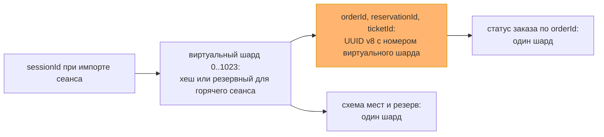
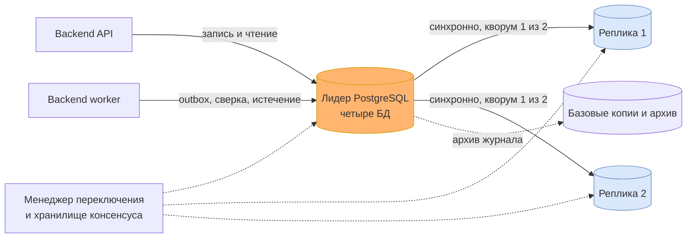

# Данные и масштабирование: хранилища, шарды и реплики

Первая половина итогового проекта — решение по данным, шаги 1–3 задания урока 24. Вторая половина, сборка всего проекта в одно решение, лежит в [итоговом решении](final-solution.md).

Наборы данных взяты из прежних работ: владельцы — из [доменной модели](domain-model.md#карта-логических-сервисов-и-владения-данными), строгость — из [жизненного цикла покупки](booking-lifecycle.md), кеши — из [frontend-архитектуры](frontend-architecture.md#кеширование-и-приватность). Пиковая нагрузка — по [A-03](assumptions.md): до 50 команд изменения в секунду. Объём за год — по новому допущению A-08: 20 000 сеансов, в среднем 800 мест на сеанс, около 3 млн проданных билетов и 5 млн созданных заказов, часть которых истекает или отменяется. Это учебные условия, а не прогноз продаж; проверяются так же, как A-03.

## Шаг 1. Наборы данных: хранилище, согласованность, кеш

Строгие наборы — те, где расхождение копий означает чужое место, второе списание или потерянную покупку. Терпимые — те, где старая копия лишь показывает прошлое и ничего не разрешает.

| Набор | Владелец и хранилище | Согласованность | Кеш-стратегия | Как растёт |
|---|---|---|---|---|
| **N1. Места сеанса и их доступность** | Booking, `booking_db` | Строгая, ACID: переход места сериализуется | Серверного кеша нет. UI держит подсказку до 5 с; право проверяет Booking | ~16 млн строк в год: места каждого сеанса |
| **N2. Резерв, заказ, намерение оплаты, билет** | Booking, `booking_db` | Строгая, ACID: одна локальная транзакция | Не кешируется: `private, no-store` | ~16 млн строк в год: по 5 млн резервов и заказов, ~3,5 млн намерений, 3 млн билетов |
| **N3. Ключи идемпотентности, inbox и outbox Booking** | Booking, `booking_db` | Строгая, ACID: фиксируются вместе с эффектом | Не кешируется никогда: промах кеша означал бы дубль | ~25 млн строк в год |
| **N4. Платёжные попытки, денежные факты, возвраты** | Payments, `payments_db` | Строгая, ACID; внешний результат сверяется с провайдером | Не кешируется | ~6 млн строк попыток и фактов, ~10 млн строк inbox/outbox в год |
| **N5. Каталог: мероприятия, сеансы, схемы залов** | Catalog, `catalog_db` | Терпимая: окно публичной устарелости 60 с | Cache-aside в reverse proxy: `s-maxage=60`, без purge, один запрос к origin на ключ | Менее 1 млн строк в год |
| **N6. Задания и попытки доставки уведомлений** | Notifications, `notifications_db` | Терпимая: статус доставки может отставать на минуты | Не кешируется | ~6 млн строк в год |

Быстрее всего растёт Booking: N1–N3 — около 58 млн строк и порядка 30–40 ГБ с индексами в год. Payments и Notifications вместе — ещё порядка 10 ГБ. Каталог мал.

**Серверный кеш (урок 23).** Отдельного кеш-сервера в первой версии нет. Единственный набор, который читают намного чаще, чем меняют, — публичный каталог, и его закрывает кеш proxy на 60 с. Остальное либо строгое, либо читается владельцем: кеш над N2–N4 нарушил бы read-your-writes, а N3 кешировать нельзя вообще. Защита от stampede нужна именно у кеша каталога: когда запись популярного сеанса истекает, proxy пропускает к Catalog один запрос за ключ, остальные ждут его ответа. Это добавлено в [договорённости по кешу](frontend-architecture.md#кеширование-и-приватность). Серверный кеш появится, если после кеша proxy p95 чтения каталога выйдет за бюджет API.

## Шаг 2. Шардировать или нет

Решение принимается для каждого набора отдельно. Каталог, Payments и Notifications малы, шарды им не нужны и при десятикратном росте. Вопрос сводится к Booking — N1–N3.

Лестница из урока снизу вверх:

| Ступень | Что упирается в Booking | Хватает? |
|---|---|---|
| Индексы | Схема мест по `sessionId`, место по `(sessionId, seatId)`, заказ по `orderId`, ключ по области и хешу | Да, все главные запросы идут по индексу |
| Кеш | Чтение схемы мест на пике | Частично: подсказка доступности в UI; кеш над строгими данными не ставим |
| Реплики чтения | — | Не нужны: строгие данные читаются с лидера, а чтение не упирается |
| Мощнее узел | Запись в пик | Не понадобился, см. расчёт ниже |
| Шарды | Запись и объём | Нет необходимости |

Пик по A-03 — 50 команд изменения в секунду. Команда резервирования пишет около пяти строк: место, резерв, заказ, ключ и сохранённый ответ; вместе с outbox и оплатой это порядка 300–500 записей строк в секунду. Одна база PostgreSQL на обычном сервере держит такой поток с запасом на порядок. Это проверяется нагрузочной проверкой A-03 до выпуска. Объём — 30–40 ГБ в год — тоже в пределах одного узла.

**Решение: шарды не вводим.** Они добавили бы издержки без выгоды: отчёт организатора по продажам обходил бы все шарды, миграции шли бы на каждом узле, резервные копии и восстановление умножились бы на число узлов.

**Горячее место шардирование не лечит.** Всплеск из A-03 — 100 покупателей на одно место — это одна строка `(sessionId, seatId)`. Шард делит строки между узлами, а здесь вся нагрузка на одну строку, и она останется на одном узле при любом числе шардов. Работают уже принятые меры: короткая транзакция без внешних вызовов, ожидание блокировки в пределах доли бюджета 1 200 мс, штатный доменный отказ проигравшим без автоматических повторов.

**Объём закрывается архивом.** Для упёршегося объёма решающая таблица урока (стр. 41) предлагает первым шагом архив по диапазону дат. Сеанс, прошедший больше года назад, больше не продаёт: payload его мест и завершённых заказов переносится в архивную секцию. Ключ, отпечаток команды и уникальность намерения по `orderId` остаются в горячей таблице бессрочно: [идентификаторы заказов не переиспользуются](interaction-model.md#повторы-ключи-и-хранение), и поздний replay не должен открыть повторную оплату.

**Сигнал к пересмотру — числом.** Шарды возвращаются в повестку, если выполнится любое из двух:
- пик устойчиво выше 500 команд изменения в секунду, то есть вдесятеро выше A-03, и вертикальный рост уже исчерпан;
- горячие данные `booking_db` без архива превысили 500 ГБ.

Обе величины выведены на [дашборд](observability-plan.md#эскиз-дашборда): поток команд Booking и размер `booking_db`.

**Ключ на будущее выбран сейчас.** Главные запросы к Booking:
1. схема мест и доступность сеанса — по `sessionId`;
2. резерв места — по `(sessionId, seatId)`;
3. статус заказа — по `orderId`, самый частый: видимая вкладка опрашивает его каждые 4–6 секунд.

Ключ — `sessionId`. Только он держит в одном шарде место, его резерв, заказ, билет и ключ команды, и покупка остаётся одной локальной транзакцией. Шардировать по `buyerId` нельзя: два покупателя одного места оказались бы в разных шардах, и исключительность места потребовала бы распределённой транзакции. По той же причине при шардировании область ключа команды `reserveSeat` дополняется `sessionId`: тот же `clientKey` с другим сеансом иначе попал бы в другой шард, и конфликт повтора не был бы замечен.

Третий запрос по случайному UUID заказа ушёл бы во все шарды — scatter-gather на самом частом чтении. Поэтому `orderId`, `reservationId` и `ticketId` несут номер виртуального шарда. Номер назначается сеансу один раз, при импорте его снимка в Booking: по умолчанию `hash(sessionId) mod 1024`, для заранее известного горячего сеанса — отдельный виртуальный шард из резервного диапазона. Формат в контрактах не меняется: это по-прежнему UUID, версии 8. Подробности — в [ADR-007](adr/ADR-007-data-single-cluster-shard-ready-ids.md).

Цена ключа по сеансу видна заранее. Популярный концерт — горячий сеанс, и все его покупки лягут в один шард: перекос по горячему ключу из урока. Поэтому горячий сеанс получает собственный виртуальный шард, который можно увезти на выделенный узел целиком; маршрут по `orderId` при этом не ломается, потому что номер шарда уже в идентификаторе. Запросы без ключа сеанса — «мои заказы» по `buyerId`, отчёт по мероприятию из многих сеансов, обход outbox и истечения в worker — при шардах обходили бы все узлы. Для первых двух заводится проекция, worker обходит шарды по очереди.

## Шаг 3. Репликация и карта шардов

**Сколько можно потерять после commit.** Для Booking и Payments — ноль. Потерянный после commit резерв означает, что место продадут второй раз; потерянный денежный факт — что деньги списаны, а покупки нет. Это нарушение инвариантов, поэтому для них нужна синхронная реплика. Для каталога и уведомлений потеря последних секунд после отказа узла допустима: публикацию организатор повторит, уведомление переотправит outbox.

**Схема: лидер и две реплики с кворумом.** Поток журнала транзакций у кластера общий, но ждать ли реплику при commit, задаётся `synchronous_commit` отдельно для каждой базы:

| База | `synchronous_commit` | Допустимая потеря после commit | При потере обеих реплик |
|---|---|---|---|
| `booking_db` | `on`, кворум «любая одна из двух» | Ноль | Новая запись останавливается |
| `payments_db` | `on`, кворум «любая одна из двух» | Ноль | Новая запись останавливается |
| `catalog_db` | `local` | Последние секунды | Продолжает работать |
| `notifications_db` | `local` | Последние секунды; outbox Booking переотправит | Продолжает работать |

Все базы пишут и читают только лидера. Реплики в первой версии нужны для доступности, а не для чтения: чтение не упирается, а строгие данные требуют read-your-writes — статус заказа сразу после оплаты с реплики показал бы прошлое. Если чтение каталога когда-нибудь станет нагрузкой на лидера, анонимные GET каталога уйдут на любую реплику, кроме текущего лидера, с порогом отставания и с уменьшением `s-maxage` на это отставание, чтобы окно 60 с не выросло.

**Как ведёт себя commit.**
- Commit в строгой базе подтверждается, когда изменение легло на лидера и хотя бы на одну реплику. Отказ любого одного узла не теряет подтверждённых данных.
- Дедлайн запроса не отменяет ожидание синхронной реплики. Если ожидание всё же прервано, PostgreSQL оставляет транзакцию закоммиченной на лидере, но, возможно, не на реплике. Такой исход обрабатывается как неизвестный: клиент получает `503`, а не успех. Если лидер в этот момент переключится, такой commit может пропасть; повтор той же команды по ключу на новом лидере либо выполнит её заново, либо получит штатный отказ. Успех, которого нет на реплике, клиенту не показывается. Подробности — в [таблице сбоев](reliability.md#тип-сбоя-и-первая-тактика).
- При потере обеих реплик commit в строгих базах не падает, а ждёт. Поэтому сигнал «кворум пуст» срочный: proxy перестаёт принимать новые команды Booking и Payments и отвечает `503` с `Retry-After`, пока кворум не восстановится. Это выбор того же [главного компромисса](architecture-drivers.md#главный-компромисс): корректность права и денег важнее доступности подтверждения.

**Отказ лидера** закрывается автоматическим переключением на самую свежую синхронную реплику. Нужен менеджер переключения с хранилищем консенсуса и ограждением старого лидера, например Patroni с etcd. Приложение находит нового лидера через список узлов в строке подключения с требованием узла для записи. Цель — до 60 секунд, в это время proxy отдаёт `503` с `Retry-After`. Цена — около 10% недельного бюджета SLI-1 на одно переключение при ровном трафике (605 с на неделю). Узлов становится шесть: три узла PostgreSQL и три узла хранилища консенсуса, если на площадке его нет.

**Резервные копии и восстановление.** Реплики не защищают от логической ошибки: ошибочная миграция или `DELETE` честно уедут на все копии. Поэтому отдельно — ежедневная базовая копия и непрерывный архив журнала с `archive_timeout` 60 с.
- При потере всех узлов RPO — до минуты.
- При логической ошибке кластер восстанавливается на отдельный экземпляр на момент до ошибки, и теряются все изменения после этой точки во всех четырёх базах. Поэтому после такого восстановления Payments сверяет с провайдером каждую операцию после точки восстановления по её reference — иначе списанные деньги потеряются.
- Восстановление репетируется раз в квартал, иначе цифры ничего не значат.

**Карта шардов — в клиенте.** Сегодня шард один, и карты нет, но место выбрано. Каждой БД владеет один модуль, а API и worker собираются [из одного артефакта](adr/ADR-001-modular-monolith.md): главный минус клиентской карты — рассинхрон версий у разных потребителей — у нас не возникает, новая карта выкатывается обоими процессами одновременно. Координатор или прокси добавили бы узел на пути каждого запроса без выигрыша. Карта — таблица «виртуальный шард → узел»; сегодня все 1024 виртуальных шарда отображаются на один кластер.

Синхронный кворум на схеме относится к `booking_db` и `payments_db`, остальные две базы реплицируются асинхронно. Отставание реплик, число синхронных реплик в кворуме и размер `booking_db` выведены на [дашборд](observability-plan.md#эскиз-дашборда), пустой кворум поднимает [срочный сигнал](observability-plan.md#три-основных-алерта).

## Что задание поймало в уже принятых решениях

**Случайный `orderId` закрывал дорогу к шардам.** Самое частое чтение системы — опрос статуса заказа — при шардировании по сеансу ушло бы во все шарды. Поменять формат идентификатора сейчас стоит нескольких бит, потом — миграции всех заказов, ссылок в событиях и сохранённых в браузерах маршрутов. Отсюда [ADR-007](adr/ADR-007-data-single-cluster-shard-ready-ids.md).

**Отказ базы в тактиках заканчивался ожиданием.** В [таблице сбоев](reliability.md#тип-сбоя-и-первая-тактика) строка про PostgreSQL сводилась к «прекратить переходы и ждать», а RPO и RTO были записаны как открытый риск. Теперь у отказа лидера есть тактика и числа, а исчерпание диска вынесено отдельной строкой: переключение его не лечит, реплики хранят тот же объём.

**Таймаут запроса мог тихо потерять подтверждённый резерв.** Бюджет времени прерывает ожидание по остатку дедлайна. С синхронной репликой это опасно: прерванное ожидание реплики оставляет commit только на лидере. Правило «дедлайн не отменяет ожидание реплики, а прерванное ожидание — неизвестный исход» записано в тактиках.

**Смена лидера требует синхронных часов.** Правило `now < expiresAt` проверяется по часам БД. После переключения часы уже другого узла, поэтому синхронизация времени на узлах кластера становится требованием: расхождение на секунды сдвинуло бы границу резерва.
