# Рендеринг, сборка и доставка frontend

Проектируемый frontend — одно CSR-приложение. HTML, CSS и JavaScript выдаются через CDN; `/api` того же origin маршрутизируется в backend. Сервер рендера не требуется. Это целевая схема для последующей реализации, а не описание уже работающего pipeline.

Основания: [архитектура frontend](frontend-architecture.md), [сценарии качества](architecture-drivers.md), [допущения](assumptions.md), [ADR-004: рендеринг](adr/ADR-004-rendering.md), [ADR-005: доставка](adr/ADR-005-delivery.md).

## Рендеринг и цена выбора

| Вариант | Значение для проекта | Решение |
|---|---|---|
| CSR | Один статический выпуск и интерактивный checkout; первый содержательный экран зависит от JS и чтения API | Первая версия |
| SSR | HTML формируется на сервере; появляются серверная задержка, гидратация, отказ рендера и отдельная эксплуатация | Пересмотр при подтверждённом SEO/HTML-требовании или проблеме первого экрана |
| SSG | Публичные страницы готовятся заранее; публикации надо обновлять, а интерактивная покупка всё равно обращается к API | Возможное развитие публичного каталога, не механизм продажи места |

Подтверждённого требования привлекать пользователей через поисковую индексацию нет. Для текущего checkout цена SSR не обоснована. CSR не объявляется быстрее SSR: выигрыш в простоте оплачивается загрузкой и выполнением клиентского кода. Быстрый TTFB статического HTML сам по себе не гарантирует быстрый LCP или доступную кнопку оплаты.

## Разделение загрузки

Начальная сборка содержит оболочку и необходимое для входного маршрута. Два явных разреза:

1. Код checkout — отдельный route chunk. Его предзагрузка возможна после выбора сеанса, до запуска ограниченного по времени резерва. Prefetch загружает код, но не создаёт заказ и не запускает оплату.
2. Раздел организатора и тяжёлый редактор схемы зала загружаются только при входе в него. Этот код не входит в покупательский initial bundle.

Ошибка отдельного chunk обрабатывается на границе маршрута. Возврат или перезагрузка страницы восстанавливает покупку по `orderId`; повторная загрузка UI не равна повтору платёжной команды. Платёжные реквизиты остаются у провайдера; конкретный клиентский SDK не выбран и в бюджет не включён как существующая зависимость.

Tree shaking проверяется по фактическому результату сборки. Он не заменяет разделение маршрутов: используемый только организатором код может быть достижимым и при этом не нужен покупателю.

## Бюджет производительности

Все числа — начальные цели Q-06, а не полученные результаты. Профиль первой проверки: Android среднего класса, 4G с ограничением 4 Мбит/с и RTT 150 мс, холодный кеш. При реализации модель устройства, браузер и профиль CPU фиксируются в отчёте для повторяемости.

| Показатель | Цель | Что именно измеряется |
|---|---|---|
| Начальный JavaScript | ≤200 KiB gzip | Суммарный JS холодного входа в каталог, включая общие зависимости |
| Дополнительный checkout chunk | ≤100 KiB gzip | Код перехода в checkout сверх уже загруженной оболочки; общие ресурсы не скрываются двойным учётом |
| TTFB HTML | p75 ≤800 мс | От начала навигации до первого байта HTML в том же профиле; время API и выполнения JS измеряется отдельно |
| LCP | p75 ≤2,5 с | Появление основного содержимого покупательского маршрута |
| INP | p75 ≤200 мс | Отклик при выборе места и взаимодействиях checkout |
| CLS | ≤0,1 | Накопленные непредусмотренные сдвиги разметки в проверяемом сценарии |

До запуска продуктового трафика lab-проверка фиксирует повторяемые холодные заходы в каталог, прямой вход в checkout и переход из сеанса. Отчёт содержит размер ресурсов и отдельные измерения; единичный прогон не выдаётся за статистику реальных пользователей. После появления трафика RUM группирует метрики по маршруту, устройству и версии frontend, включая размер выборки и окно наблюдения.

Бюджет блокирует продвижение сборки при регрессии в согласованном профиле. Если цель недостижима, сначала проверяются состав бандла, загрузка данных и тяжёлые операции UI; смена рендеринга обсуждается по результату, а не по баллу одного инструмента.

## Артефакт и конфигурация

Frontend выпускается одним набором файлов с manifest и идентификатором исходного commit. Lockfile и фиксированная среда сборки обеспечивают повторяемость установки зависимостей. Артефакт собирается один раз и затем продвигается между окружениями без пересборки адресов API.

Относительный `/api` направляется в backend соответствующего окружения. Открытая runtime-конфигурация может содержать только несекретные значения; ключи провайдера, доступ к БД и сервисные токены остаются на сервере. Frontend и backend имеют собственные артефакты, даже когда их исходники находятся в одном репозитории. API и worker backend используют одну версию backend-артефакта.

JS/CSS публикуются под URL с хешем содержимого и не перезаписываются новым содержимым. HTML использует `Cache-Control: no-cache` и выбирает нужный manifest. Старые assets не удаляются при выкладке: открытая вкладка должна догрузить chunk предыдущего выпуска. Очистка версий — отдельная операция после завершения поддержки соответствующих клиентов.

## CI/CD и окружения

```mermaid
flowchart LR
    src["Изменения и review"] --> fast["Типы · lint · границы импортов"]
    fast --> checks["Контракты · критические сценарии"]
    checks --> build["Одна сборка с commit SHA"]
    build --> budget["Размеры ресурсов · бюджет первого экрана"]
    budget --> artifact["Хранилище неизменяемых артефактов"]
    artifact --> preview["Изолированное preview"]
    artifact --> staging["Staging и smoke"]
    staging --> approval["Подтверждение выпуска"]
    approval --> prod["Production"]
    prod --> observe["Проверка пути покупки и метрики"]
    observe -->|"Регрессия"| rollback["Предыдущий manifest / HTML"]
```

| Окружение | Назначение | Изоляция |
|---|---|---|
| Local | Работа разработчика и быстрая проверка | Тестовые данные и зависимости; без production-секретов |
| Preview | Проверка будущего PR в браузере | Отдельные БД/данные, sandbox оплаты, тестовый приёмник уведомлений, ограниченный доступ |
| Staging | Интеграция зафиксированной версии frontend и backend | Тестовые учётные записи и платежи, конфигурация по модели production |
| Production | Реальные покупки | Выпуск подтверждается после результатов staging; отдельные секреты и данные |

Предлагаемое preview создаётся для PR, живёт до его закрытия и удаляется вместе со своими данными; ежедневная очистка удаляет окружения закрытых PR, пропущенные основным обработчиком. Название окружения связывается с PR и версией артефакта. Сейчас PR и удалённые окружения не создаются.

Быстрые проверки выполняются раньше сборки. Контрактные проверки не подменяются mock-ответом, повторяющим предположения UI. Smoke включает доступность каталога, резерв тестового места, создание одной sandbox-попытки и восстановление заказа. Критический сценарий не отправляет реальные деньги и уведомления пользователям.

Код и pipeline пока отсутствуют. На текущем этапе проверяются документация, совместимость решений и покрытие рубрики; исполняемые конфигурации и искусственные тесты для видимости CI не добавлены.

## Выпуск, откат и совместимость

Перед публикацией HTML проверяется доступность всех ресурсов manifest. Сначала размещаются assets, затем переключается HTML на новую версию. После выпуска наблюдаются ошибки загрузки, ошибки маршрутов и показатели пользовательского пути с привязкой к версии.

При недоступном checkout или регрессии бюджета ответственный за выпуск прекращает продвижение и переключает HTML/manifest на предыдущий рабочий артефакт. Откат frontend не меняет состояние БД, резервов или платежей. Уже открытая вкладка может продолжать использовать прежнюю версию, поэтому backend сохраняет её контракт на время поддержки активных клиентов; несовместимый API не выпускается одновременно с UI без отдельного переходного плана.

Проверка отката включает открытую до релиза вкладку: переход к checkout, загрузку старого chunk и чтение прежнего заказа. Если UI требует обновления, он предлагает перезагрузить страницу с сохранённым `orderId`, а не начать оплату заново.

API и worker backend не масштабируются и не откатываются по правилам статического CDN: они выполняют операции и используют устойчивое состояние в четырёх БД. Число экземпляров backend выбирается после измерения нагрузки и проверки конкурентной обработки. Frontend не требует отдельного SSR-масштабирования; CDN отдаёт статику, а `/api` остаётся отдельным измеряемым участком пути.

## Критерии приёмки будущей поставки

| Проверка | Условие прохождения |
|---|---|
| Продвижение preview → staging → production | Совпадает идентификатор артефакта; меняется только конфигурация окружения |
| Холодная загрузка и переход checkout | Бюджеты Q-06 соблюдены в описанном профиле, отчёт содержит реальные измерения |
| Выпуск во время открытого заказа | Старые assets доступны, API совместим, состояние покупки восстанавливается |
| Повтор sandbox-оплаты после timeout | Используется прежняя попытка, нет второй операции провайдера: Q-02 |
| Кеширование HTML и личных данных | HTML ревалидируется, приватные ответы имеют `private, no-store`: Q-07 |
| Закрытие PR | Preview и его изолированные данные удалены, staging/production не затронуты |
| Rollback | Возвращён нужный артефакт, smoke пройден, состояние заказов и оплаты не переигрывается |

Эти проверки ограничены рисками выбранной архитектуры. Процент покрытия без связи со сценарием не используется как самостоятельное доказательство качества.
