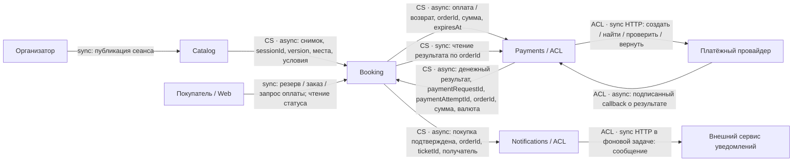
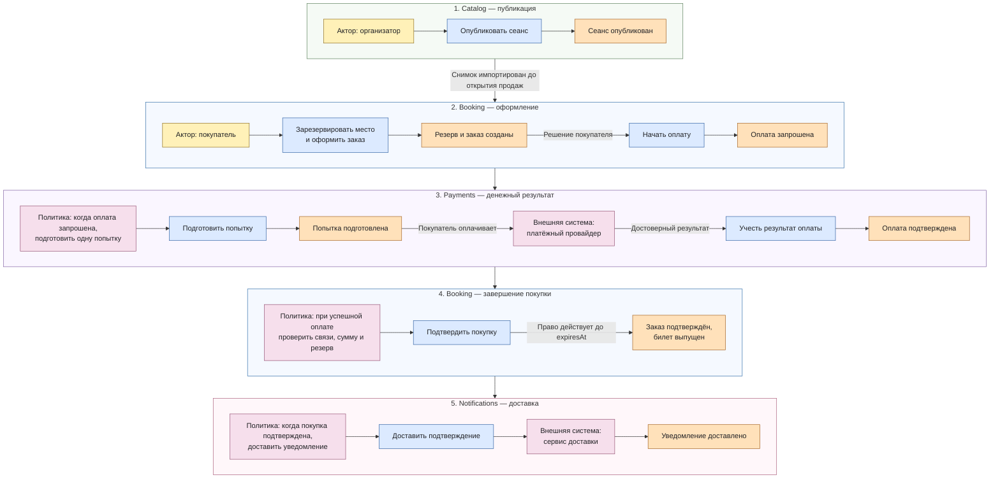

# Декомпозиция и доменная модель

Проектируемая модель для ДЗ по декомпозиции и дальнейших итераций курса. Приложение пока не реализовано. Термины определены в [CONTEXT.md](../CONTEXT.md), учебные допущения — в [assumptions.md](assumptions.md), переходы состояний — в [booking-lifecycle.md](booking-lifecycle.md).

## Возможности бизнеса

| Возможность | Класс | Владелец и причина |
|---|---|---|
| Публиковать мероприятия, сеансы и схемы залов | Supporting | Catalog подготавливает предмет продажи |
| Показывать доступность места на сеансе | Core | Booking владеет ограниченным ресурсом |
| Исключительно резервировать и освобождать место | Core | Booking защищает от конкурирующих покупок |
| Вести заказ и подтверждать покупку | Core | Booking согласует право на место с результатом оплаты |
| Интегрироваться с платёжным провайдером | Supporting | Payments согласует внешний денежный результат; собственный эквайринг не входит в проект |
| Урегулировать деньги по несостоявшейся покупке | Supporting | Payments ведёт возврат и его сверку с провайдером; решение, нужен ли возврат, принимает Booking по сроку резерва |
| Выпускать и показывать билет | Core | Booking фиксирует приобретённое право на место |
| Доставлять подтверждение покупки | Generic | Notifications решает стандартную задачу доставки |

Восемь возможностей не требуют восьми сервисов. Доступность, резерв, заказ и билет меняются по одному правилу покупки; их объединение в Booking сохраняет высокую сплочённость и одну локальную границу атомарности.

## Карта логических сервисов и владения данными

| Граница | Ответственность | Собственные данные |
|---|---|---|
| Catalog | Публикует описание того, что продаётся | Мероприятия, площадки, сеансы, версии схем и опубликованных условий продажи; `catalog_db` / роль Catalog |
| Booking | Защищает единственное право на место на всём пути покупки | Импортированные снимки сеансов, доступность мест, резервы, заказы с зафиксированной суммой, билеты, журнал процесса, inbox/outbox; `booking_db` / роль Booking |
| Payments | Согласует денежную операцию с внешним провайдером | Платёжные попытки, стабильные внешние идентификаторы, подтверждения, сверки, возвраты, inbox/outbox; `payments_db` / роль Payments |
| Notifications | Доставляет информацию после покупки | Задания, попытки и результаты доставки, inbox/outbox; `notifications_db` / роль Notifications |

По A-07 это **четыре отдельные базы и четыре роли**, в одном кластере PostgreSQL. Каждый модуль использует только свою роль. Между базами нет SQL JOIN, внешних ключей и общей транзакции. Совпадающие идентификаторы — ссылки в контрактах, а не разрешение читать чужие таблицы.

Физическая упаковка остаётся модульным монолитом: один backend artifact с API и фоновыми обработчиками. Логическая граница здесь означает ответственность и данные; она не заявляет независимое развёртывание. Все четыре БД живут в одном кластере PostgreSQL с двумя репликами: для Booking и Payments отказ узла не теряет подтверждённых данных. Разделение кластера потребует отдельного обоснования, см. [данные и масштабирование](data-scaling.md).

Это осознанная цена выполнения требования курса о самостоятельном владении данными: сложнее миграции и восстановление обмена, чем при одной общей БД. Пока избегаем четырёх независимых релизов и межсервисной сети. Физическую форму объясняет [ADR-001](adr/ADR-001-modular-monolith.md), владение и отвергнутые границы — [ADR-002](adr/ADR-002-domain-ownership.md).

## Context Map

`sync` у внешнего HTTP-вызова описывает ожидание ответа на конкретный запрос; завершение оплаты покупателем остаётся асинхронным процессом. Внутренний `async` означает сохранённое задание и повторяемую доставку; отдельный брокер из диаграммы не следует.

Catalog — upstream Supplier, Booking — downstream Customer: формат публикации согласован под импорт продажи. До открытия продаж Booking принимает опубликованный снимок; повтор или старая версия не сбрасывают резервы, проданные места и суммы заказов. Изменение существующего места не может отнять уже выданное право. Обновление схемы при открытых продажах требует отдельного правила; для первой версии применяется зафиксированный снимок.

**CS — Customer–Supplier (заказчик–поставщик), ACL — Anti-Corruption Layer (перевод внешней модели).** Стрелки показывают движение данных; роли сторон и ответственность за изменение контракта заданы ниже. Пользовательские команды не являются отношениями двух bounded context.

| Отношение | Тип и роли | Кто отвечает за изменение |
|---|---|---|
| Catalog → Booking | CS: Catalog — Supplier, Booking — Customer | Catalog сохраняет совместимость опубликованного снимка; Booking формулирует нужные для продажи данные и обновляет импорт до перехода на несовместимую версию |
| Booking ↔ Payments | CS: Payments — Supplier операций и денежных фактов, Booking — Customer | Booking задаёт потребности покупки через PaymentPort. Payments сохраняет договорённый смысл команд и результатов; несовместимое изменение согласуется с Booking и вводится новой версией после готовности получателя |
| Booking → Notifications | CS: Booking — Supplier факта покупки, Notifications — Customer | Booking поддерживает совместимость события. Notifications меняет шаблоны и каналы внутри своей границы; потребность в новых данных согласует с Booking, не получая права менять покупку |
| Payments ↔ платёжный провайдер | ACL внутри Payments | Payments обновляет адаптер PaymentGateway при изменении внешнего API и проверяет соответствие прежним денежным правилам; внешний статус не становится статусом заказа автоматически |
| Notifications ↔ сервис доставки | ACL внутри Notifications | Notifications переводит запросы и результаты внешнего API в свои понятия доставки. Смена провайдера затрагивает этот адаптер; контракт события покупки и состояние Booking сохраняются |

Booking и Payments используют согласованный **Published Language** для команд и денежных фактов. Это формат обмена внутри указанного Customer–Supplier, а не обещание независимых релизов. Общий backend-артефакт и ограничение физической автономии остаются прежними.

## Event Storming критического сценария

Лента успешной покупки читается сверху вниз, внутри группы — слева направо. Рамка обозначает владельца событий; Booking появляется в двух местах процесса и остаётся одним контекстом. Цвета: жёлтый — актор, синий — команда, оранжевый — факт, розовый — политика или внешняя система.

Публикация и подтверждение покупки относятся к разным кластерам. Возврат из Payments в Booking показывает различие денежного результата и права на место: покупка подтверждается только после проверки свежего времени БД и собственного резерва. Альтернативы ленты собраны в таблице; отказ команды не превращается в успешное событие.

| Актор / стимул | Команда | Зафиксированный факт | Владелец / следующая реакция |
|---|---|---|---|
| Организатор | Опубликовать сеанс | Сеанс опубликован | Catalog; Booking импортирует снимок до продаж |
| Покупатель | Зарезервировать место и оформить заказ | Резерв и заказ созданы | Одна транзакция Booking фиксирует место, сумму и владельца; конкурент получает отказ |
| Покупатель | Начать оплату заказа | Оплата запрошена | Booking сохраняет задание Payments |
| Обработчик Payments | Подготовить единственную попытку | Платёжная попытка подготовлена | Payments вызывает провайдера со стабильным идентификатором |
| Провайдер / сверка | Учесть достоверный результат | Оплата подтверждена либо отклонена | Payments сохраняет результат и outbox |
| Успех до срока | Подтвердить покупку | Заказ подтверждён, билет выпущен | Booking атомарно фиксирует право и outbox |
| Серверное время | Завершить резерв | Резерв истёк | Booking освобождает только удерживаемое этим резервом место; заказ не может подтвердиться |
| Покупатель до запроса оплаты / достоверный отказ оплаты | Отменить покупку | Заказ отменён | Booking завершает резерв и освобождает только его место |
| Сопоставленный поздний успех / отменённый заказ | Урегулировать полученные деньги | Возврат потребован | Booking сохраняет задание; Payments ведёт возврат |
| Неизвестный ответ провайдера | Сверить существующую операцию | Результат уточнён | Payments не создаёт новое списание |
| Подтверждённая покупка | Доставить подтверждение | Уведомление доставлено либо доставка отложена | Notifications; право на билет не меняется |

Альтернативные ветки — часть модели, не исключения из успешного сценария. Факт «оплата подтверждена» ещё не означает факт «покупка подтверждена»: действительность резерва проверяет Booking. Факт с несопоставимой суммой, валютой или ссылкой на покупку сохраняется для разбора и сверки; автоматический возврат относится к достоверной сопоставленной оплате истёкшего/отменённого заказа.

## Связанность и пример DIP

Booking зависит от узкого **PaymentPort**: запросить оплату заказа с суммой и сроком, получить известный результат, запросить возврат. Он передаёт собственный `orderId` и не получает внутренние сущности Payments или статусы конкретного провайдера. Реализация порта сохраняет/принимает задания идемпотентно; восстановление не зависит от жизни HTTP-запроса.

Payments, в свою очередь, зависит от **PaymentGateway**: создать или найти существующую денежную операцию, проверить её, вернуть деньги. Один адаптер переводит провайдерские поля и ошибки в понятия Payments. Внутренний `paymentAttemptId` связан со стабильным внешним reference. Это пример DIP для Q-05: замена провайдера должна затрагивать адаптер и его контрактные проверки, сохраняя правила Booking. Это проектная цель, не уже измеренная локальность изменений.

| Риск | Как ограничен | Цена / остаточный риск |
|---|---|---|
| Общие таблицы размывают владельцев | Отдельные БД/роли, только публичные порты и сообщения | Нет общей транзакции; нужны inbox/outbox |
| Провайдерские статусы проникают в заказ | ACL Payments; Booking получает денежные факты | Нужно явно сопоставлять неизвестные и противоречивые результаты |
| Потеря между фиксацией факта и доставкой | Outbox отправителя; inbox и результат в транзакции получателя | Повторы и задержка согласования остаются |
| Доставка письма блокирует покупку | Отдельный Notifications после commit покупки | Уведомление может прийти позже |
| Витринный кеш или frontend подтверждает место | Авторитетный переход только в Booking | Возможен отказ после показа свободного места |

## Сверка ленты с декомпозицией

Границы, полученные на ленте, сопоставлены с владельцами из таблицы выше. Совпадение здесь — результат проверки, а не оправдание: расхождения искались по каждому кластеру отдельно.

| Кластер ленты | Владелец из декомпозиции | Итог сверки |
|---|---|---|
| Публикация сеанса | Catalog | Совпало. Язык публикации отличается от языка продажи, граница проходит по смене словаря |
| Оформление: резерв, заказ, запрос оплаты | Booking | Совпало. Все три факта меняются одним правилом покупки |
| Денежный результат: попытка, вызов провайдера, сверка | Payments | Совпало. Отдельный жизненный цикл денег и собственный внешний контракт |
| Завершение покупки: подтверждение, билет | Booking | Совпало по владельцу. Кластер появляется на ленте второй раз, разделённый оплатой: лента показывает порядок времени, а не порядок ответственности |
| Доставка подтверждения | Notifications | Совпало. Кластер не сцепился ни с одним соседним: у доставки своя мера успеха |
| Завершение резерва по времени | Booking | Расхождение формы, не состава. На ленте это событие без актора, то есть политика; в декомпозиции оно было спрятано внутри возможности «исключительно резервировать и освобождать место». Новый владелец не понадобился, но правило стало явным |
| Урегулирование поздней оплаты | Booking решает, Payments исполняет | Уточнение. До ленты ответственность выглядела единой; события показали, что «оплата подтверждена» и «покупка подтверждена» — разные факты разных владельцев, поэтому компенсация принадлежит Payments, а решение о праве — Booking |

Вывод: состав владельцев после Event Storming не изменился, четырёх границ достаточно. Метод дал не новые сервисы, а два уточнения процесса — явную политику истечения и разделение денежного факта с фактом покупки. Оба уточнения перенесены в [жизненный цикл](booking-lifecycle.md) и в таблицу альтернатив выше.
