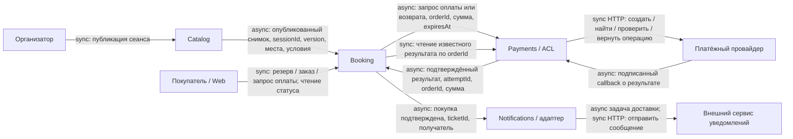

# Декомпозиция и доменная модель

Проектируемая модель для ДЗ по декомпозиции и дальнейших итераций курса. Приложение пока не реализовано. Термины определены в [CONTEXT.md](../CONTEXT.md), учебные допущения — в [assumptions.md](assumptions.md), переходы состояний — в [booking-lifecycle.md](booking-lifecycle.md).

## Возможности бизнеса

| Возможность | Класс | Владелец и причина |
|---|---|---|
| Публиковать мероприятия, сеансы и схемы залов | Supporting | Catalog подготавливает предмет продажи |
| Показывать доступность места на сеансе | Core | Booking владеет ограниченным ресурсом |
| Исключительно резервировать и освобождать место | Core | Booking защищает от конкурирующих покупок |
| Вести заказ и подтверждать покупку | Core | Booking согласует право на место с результатом оплаты |
| Интегрироваться с платёжным провайдером | Supporting | Payments согласует внешний денежный результат; собственный эквайринг не входит в проект |
| Выпускать и показывать билет | Core | Booking фиксирует приобретённое право на место |
| Доставлять подтверждение покупки | Generic | Notifications решает стандартную задачу доставки |

Семь возможностей не требуют семи сервисов. Доступность, резерв, заказ и билет меняются по одному правилу покупки; их объединение в Booking сохраняет высокую сплочённость и одну локальную границу атомарности.

## Карта логических сервисов и владения данными

| Граница | Ответственность | Собственные данные |
|---|---|---|
| Catalog | Публикует описание того, что продаётся | Мероприятия, площадки, сеансы, версии схем и опубликованных условий продажи; `catalog_db` / роль Catalog |
| Booking | Управляет единственным правом на место и результатом покупки | Импортированные снимки сеансов, доступность мест, резервы, заказы с зафиксированной суммой, билеты, журнал процесса, inbox/outbox; `booking_db` / роль Booking |
| Payments | Согласует денежную операцию с внешним провайдером | Платёжные попытки, стабильные внешние идентификаторы, подтверждения, сверки, возвраты, inbox/outbox; `payments_db` / роль Payments |
| Notifications | Доставляет информацию после покупки | Задания, попытки и результаты доставки, inbox/outbox; `notifications_db` / роль Notifications |

По A-07 это **четыре отдельные базы и четыре роли**, возможно в одном экземпляре PostgreSQL. Каждый модуль использует только свою роль. Между базами нет SQL JOIN, внешних ключей и общей транзакции. Совпадающие идентификаторы — ссылки в контрактах, а не разрешение читать чужие таблицы.

Физическая упаковка остаётся модульным монолитом: один backend artifact с API и фоновыми обработчиками. Логическая граница здесь означает ответственность и данные; она не заявляет независимое развёртывание. Общий экземпляр PostgreSQL остаётся общей точкой отказа. Его разделение потребует отдельного обоснования.

Это осознанная цена выполнения требования курса о самостоятельном владении данными: сложнее миграции и восстановление обмена, чем при одной общей БД. Пока избегаем четырёх независимых релизов и межсервисной сети. Физическую форму объясняет [ADR-001](adr/ADR-001-modular-monolith.md), владение и отвергнутые границы — [ADR-002](adr/ADR-002-domain-ownership.md).

## Context Map

`sync` у внешнего HTTP-вызова описывает ожидание ответа на конкретный запрос; завершение оплаты покупателем остаётся асинхронным процессом. Внутренний `async` означает сохранённое задание и повторяемую доставку; отдельный брокер из диаграммы не следует.

Catalog — upstream Supplier, Booking — downstream Customer: формат публикации согласован под импорт продажи. До открытия продаж Booking принимает опубликованный снимок; повтор или старая версия не сбрасывают резервы, проданные места и суммы заказов. Изменение существующего места не может отнять уже выданное право. Обновление схемы при открытых продажах требует отдельного правила; для первой версии применяется зафиксированный снимок.

Booking и Payments взаимодействуют через согласованный Published Language: запрос операции и отдельный денежный факт. Payments использует ACL к провайдеру: внешний статус не становится статусом заказа автоматически. Notifications — downstream Customer событий покупки, не участник её подтверждения.

## Event Storming критического сценария

| Актор / стимул | Команда | Зафиксированный факт | Владелец / следующая реакция |
|---|---|---|---|
| Организатор | Опубликовать сеанс | Сеанс опубликован | Catalog; Booking импортирует снимок до продаж |
| Покупатель | Зарезервировать место и оформить заказ | Резерв и заказ созданы | Одна транзакция Booking фиксирует место, сумму и владельца; конкурент получает отказ |
| Покупатель | Начать оплату заказа | Оплата запрошена | Booking сохраняет задание Payments |
| Обработчик Payments | Подготовить единственную попытку | Платёжная попытка подготовлена | Payments вызывает провайдера со стабильным идентификатором |
| Провайдер / сверка | Учесть достоверный результат | Оплата подтверждена либо отклонена | Payments сохраняет результат и outbox |
| Успех до срока | Подтвердить покупку | Заказ подтверждён, билет выпущен | Booking атомарно фиксирует право и outbox |
| Серверное время | Завершить резерв | Резерв истёк | Booking освобождает только удерживаемое этим резервом место; заказ не может подтвердиться |
| Покупатель до запроса оплаты / достоверный отказ оплаты | Отменить покупку | Заказ отменён | Booking завершает резерв и освобождает только его место |
| Поздний успех / отменённый заказ | Урегулировать полученные деньги | Возврат потребован | Booking сохраняет задание; Payments ведёт возврат |
| Неизвестный ответ провайдера | Сверить существующую операцию | Результат уточнён | Payments не создаёт новое списание |
| Подтверждённая покупка | Доставить подтверждение | Уведомление доставлено либо доставка отложена | Notifications; право на билет не меняется |

Альтернативные ветки — часть модели, не исключения из успешного сценария. Факт «оплата подтверждена» ещё не означает факт «покупка подтверждена»: действительность резерва проверяет Booking.

## Связанность и пример DIP

Booking зависит от узкого **PaymentPort**: запросить оплату заказа с суммой и сроком, получить известный результат, запросить возврат. Он передаёт собственный `orderId` и не получает внутренние сущности Payments или статусы конкретного провайдера. Реализация порта сохраняет/принимает задания идемпотентно; восстановление не зависит от жизни HTTP-запроса.

Payments, в свою очередь, зависит от **PaymentGateway**: создать или найти существующую денежную операцию, проверить её, вернуть деньги. Один адаптер переводит провайдерские поля и ошибки в понятия Payments. Внутренний `paymentAttemptId` связан со стабильным внешним reference. Это пример DIP для Q-05: замена провайдера должна затрагивать адаптер и его контрактные проверки, сохраняя правила Booking. Это проектная цель, не уже измеренная локальность изменений.

| Риск | Как ограничен | Цена / остаточный риск |
|---|---|---|
| Общие таблицы размывают владельцев | Отдельные БД/роли, только публичные порты и сообщения | Нет общей транзакции; нужны inbox/outbox |
| Провайдерские статусы проникают в заказ | ACL Payments; Booking получает денежные факты | Нужно явно сопоставлять неизвестные и противоречивые результаты |
| Потеря между фиксацией факта и доставкой | Outbox отправителя; inbox и результат в транзакции получателя | Повторы и задержка согласования остаются |
| Доставка письма блокирует покупку | Отдельный Notifications после commit покупки | Уведомление может прийти позже |
| Витринный кеш или frontend подтверждает место | Авторитетный переход только в Booking | Возможен отказ после показа свободного места |

Декомпозиция урока 3 и Event Storming урока 4 согласованы: дополнительные ветки не потребовали новых владельцев. Они уточнили процесс Payments ↔ Booking и объяснили, почему резерв, заказ и билет остаются вместе.
