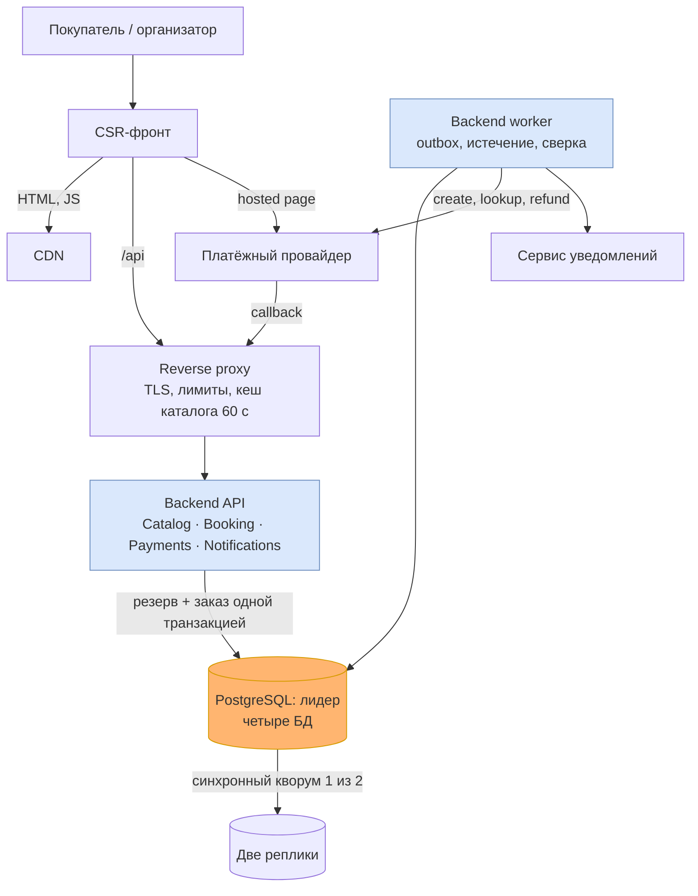

# Итоговое архитектурное решение: Event Ticket Booking целиком

Вторая половина итогового проекта. Решения разделов «Декомпозиция» — «Надёжность» приняты в прошлых работах и здесь собраны вместе; новые решения итогового проекта — раздел «Данные» и следующие из него строки об отказе базы, подробно в [данных и масштабировании](data-scaling.md). Каждое решение выводится из драйверов, с которых проект начинался.

**Тема №6 «Чек-аут / бронирование»** — в кабинете: «Транзакционный Check-Out (бронирование). Система оформления с гарантиями идемпотентности и паттерном Saga-lite, балансирующая между строгой транзакционностью и производительностью». Покупатель резервирует уникальное место на 10 минут, оплачивает его у внешнего провайдера и получает билет. Главная сложность — согласовать ограниченный ресурс с внешним платежом, который может прийти поздно, дважды или с неизвестным исходом.

**Драйверы** — сценарии качества из [архитектурных драйверов](architecture-drivers.md):
- **Q-01** — одно место нельзя продать дважды;
- **Q-02** — повтор не создаёт второго списания;
- **Q-03** — истёкший резерв не подтверждается;
- **Q-04** — принятая работа переживает частичный отказ;
- **Q-05** — замена платёжного провайдера локальна;
- **Q-06** — первый экран быстрый на среднем Android;
- **Q-07** — чужой заказ и билет не раскрываются.

Главный компромисс всего проекта: [корректность права на место и денег важнее доступности подтверждения](architecture-drivers.md#главный-компромисс).

Баланс между строгой транзакционностью и производительностью держится так: ACID — только внутри короткой локальной транзакции одного владельца и без внешних вызовов; между модулями — outbox и повторяемая доставка; оплата отвечает `202` сразу после сохранения намерения, а банк вызывается в фоне. Цена строгости названа: горячее место сериализуется, и проигравшие получают отказ; каждый commit ждёт сетевой круг до синхронной реплики; строгие данные не кешируются и не читаются с реплик.

## Декомпозиция: какие части и где границы

| Решение | Документ | Какой драйвер держит |
|---|---|---|
| Модульный монолит на старте | [ADR-001](adr/ADR-001-modular-monolith.md) | Q-01, Q-03: строгие переходы остаются локальными транзакциями |
| Четыре владельца: Catalog, Booking, Payments, Notifications, каждый со своей БД | [Доменная модель](domain-model.md#карта-логических-сервисов-и-владения-данными), [ADR-002](adr/ADR-002-domain-ownership.md) | Q-05: провайдер изолирован в Payments |
| Резерв, заказ и билет — одна граница Booking | [Жизненный цикл](booking-lifecycle.md#атомарная-граница-booking) | Q-01, Q-03 |
| Резерв живёт 10 минут по часам БД, срок проверяется после блокировки места, уборка отстаёт не больше чем на 30 с | [Гонка оплаты и истечения](booking-lifecycle.md#гонка-оплаты-и-истечения), [A-02](assumptions.md) | Q-03 |
| Банк скрыт за PaymentPort и PaymentGateway | [DIP](domain-model.md#связанность-и-пример-dip) | Q-05 |
| Границы перепроверены лентой Event Storming | [Сверка](domain-model.md#сверка-ленты-с-декомпозицией) | Все: лента разделила «оплата подтверждена» и «покупка подтверждена» |

## Frontend и доставка

| Решение | Документ | Какой драйвер держит |
|---|---|---|
| Один CSR-фронт на FSD, без SSR, BFF и микрофронтендов | [Frontend-архитектура](frontend-architecture.md#fsd-и-зависимости), [ADR-003](adr/ADR-003-frontend-boundaries.md), [ADR-004](adr/ADR-004-rendering.md) | Q-06, Q-05 |
| Checkout и редактор организатора — отдельные chunks; цель 200 KiB, порог сборки 220 KiB | [Доставка](delivery.md#бюджет-производительности) | Q-06 |
| Один неизменяемый артефакт, preview на PR, откат manifest без потери открытого checkout | [Доставка](delivery.md#cicd-и-окружения), [ADR-005](adr/ADR-005-delivery.md) | Q-02, Q-06 |
| UI не подтверждает покупку по кешу, таймеру или редиректу; восстанавливается по `orderId` | [Состояние и восстановление](frontend-architecture.md#состояние-и-восстановление) | Q-02, Q-03 |

## Взаимодействие и доступ

| Решение | Документ | Какой драйвер держит |
|---|---|---|
| Покупка — Saga-lite с оркестратором Booking: шаги — локальные транзакции владельцев, компенсации — отмена заказа с освобождением места и полный возврат; доставка между модулями через durable outbox и worker, без брокера | [Модель взаимодействия](interaction-model.md#координация-и-границы-транзакций), [ADR-006](adr/ADR-006-durable-orchestration.md) | Q-01, Q-02, Q-03, Q-04 |
| Запрос оплаты отвечает `202` после сохранения намерения, банк вызывается в фоне | [Один эндпоинт](interaction-model.md#один-эндпоинт), [OpenAPI](../contracts/payment-request.openapi.yaml) | Q-02, Q-04 |
| Денежный факт — версионированное событие `payment.succeeded.v1` | [Одно событие](interaction-model.md#одно-событие), [JSON Schema](../contracts/payment-succeeded.v1.schema.json) | Q-02 |
| Одна попытка оплаты на заказ; у каждого опасного повтора — устойчивый ключ и таблица, где его отметка фиксируется вместе с эффектом | [Повторы и ключи](interaction-model.md#повторы-ключи-и-хранение) | Q-02 |
| Поздний успех после истечения ведёт к возврату, билет не выпускается | [Гонка оплаты и истечения](booking-lifecycle.md#гонка-оплаты-и-истечения) | Q-01, Q-03 |
| Вход через reverse proxy; владельца заказа проверяет модуль при каждом запросе | [Граница и BFF](frontend-architecture.md#клиенты-и-необходимость-bff) | Q-07 |

## Надёжность и наблюдаемость

| Решение | Документ | Какой драйвер держит |
|---|---|---|
| Каждый тип сбоя с тактикой первой очереди, включая плановый выкат и отказ лидера БД | [Тактики](reliability.md#тип-сбоя-и-первая-тактика) | Q-04 |
| Экран размечен на обязательные и необязательные части; деградация не разрешает билет по кешу | [Части экрана](reliability.md#обязательные-и-необязательные-части-экрана) | Q-01, Q-02 |
| Бюджет времени: 2 с API, 3 с proxy, 4 с от нажатия до результата | [Бюджет](reliability.md#бюджет-времени-и-повторы) | Q-01, Q-06 |
| Предохранитель только на исходящий `create` к провайдеру | [Изоляция](reliability.md#изоляция-и-восстановление) | Q-04: сверка не встаёт при отказе банка |
| Три SLI со знаменателями и бюджетом ошибок в единицах SLI | [SLI и SLO](observability-plan.md#sli-slo-и-бюджет-ошибок) | Q-01, Q-04, Q-06 |
| Три алерта на симптом покупателя и три служебных | [Алерты](observability-plan.md#три-основных-алерта) | Q-01, Q-02, Q-04 |
| Запрос и фоновая работа связаны контекстом трассировки через outbox | [Связь запросов и фоновой работы](quality-and-operations.md#связь-запросов-и-фоновой-работы) | Q-04 |
| Пять рисков с приоритетом и условием остановки выпуска | [Риски](quality-and-operations.md#пять-значимых-рисков) | Q-01, Q-02, Q-03, Q-04, Q-06, Q-07 |

## Данные

| Решение | Документ | Какой драйвер держит |
|---|---|---|
| Шесть наборов размечены на строгие и терпимые; строгие не кешируются на сервере и читаются только с лидера, доступность мест — подсказка в UI до 5 с | [Наборы данных](data-scaling.md#шаг-1-наборы-данных-хранилище-согласованность-кеш) | Q-01, Q-02 |
| Кеша в приложении и кеш-сервера нет; каталог — read-through в proxy на 60 с, один запрос к origin на ключ | [Кеш](data-scaling.md#шаг-1-наборы-данных-хранилище-согласованность-кеш), [карта кешей](frontend-architecture.md#кеширование-и-приватность) | Q-06, Q-07 |
| Шардов нет; ключ на будущее `sessionId`, идентификаторы покупки несут виртуальный шард, карта шардов — в клиенте. Горячее место — одна строка, его шарды не лечат | [Шардировать или нет](data-scaling.md#шаг-2-шардировать-или-нет), [ADR-007](adr/ADR-007-data-single-cluster-shard-ready-ids.md) | Q-01 |
| Лидер и две реплики с синхронным кворумом на весь кластер: потеря после commit — ноль во всех базах при одной настройке | [Репликация](data-scaling.md#шаг-3-репликация-и-карта-шардов) | Q-01, Q-02, Q-04 |
| Архив журнала и базовые копии от логической ошибки; после восстановления продажи открываются только после сверки по реестру провайдера | [Резервные копии](data-scaling.md#шаг-3-репликация-и-карта-шардов) | Q-02, Q-04 |

## Система одной картинкой

[C4 Containers](system-containers.md) показывает лидера кластера; реплики — его копии со всеми четырьмя БД, кеш каталога живёт в proxy.

## Что осталось открытым

У каждого вопроса записано условие, при котором к нему возвращаться.

1. **Вторая попытка оплаты внутри живого резерва.** Сейчас после отказа карты покупатель теряет место. Возвращаться, если доля отказов карты заметна в продажах: меняется только правило единственности намерения, резерв и срок остаются. См. [модель взаимодействия](interaction-model.md#один-эндпоинт).
2. **Выкат без простоя.** Один процесс backend даёт окно до 30 секунд на каждый выпуск — около 5% недельного бюджета SLI-1. Возвращаться, если выкатов больше одного-двух в неделю: второй процесс backend с балансировкой по пробам. См. [тактики](reliability.md#тип-сбоя-и-первая-тактика).
3. **Цена переключения лидера БД.** Одно переключение — около 10% недельного бюджета SLI-1. Возвращаться, если переключения случаются чаще раза в месяц: разбирать их причины и настраивать обнаружение отказа; третья реплика здесь не помогает, она снижает риск пустого кворума. См. [ADR-007](adr/ADR-007-data-single-cluster-shard-ready-ids.md).
4. **Шарды.** При пике выше 500 команд изменения в секунду после исчерпания вертикального роста или 500 ГБ горячих секций Booking, см. [ADR-007](adr/ADR-007-data-single-cluster-shard-ready-ids.md).
5. **Гарантии платёжного провайдера.** Идемпотентность 24 часа и поиск по reference из [A-05](assumptions.md) — критерии выбора, ещё не проверенные на конкретном провайдере.
6. **Модель доступа и развёртывание.** Вход, роли организатора и объекты кластера описаны только на уровне периметра; отдельной модели аутентификации и раскладки по объектам Kubernetes в проекте нет. Возвращаться при выборе провайдера входа и площадки.
7. **Второй регион.** Драйверы его не требуют. Появится требование пережить потерю площадки — начинать с модели согласованности между регионами.

## Как читать проект

Начать с [README](../README.md) и [оглавления домашних заданий](homework/README.md). Дальше по порядку курса: [драйверы](architecture-drivers.md) → [доменная модель](domain-model.md) → [жизненный цикл](booking-lifecycle.md) → [frontend](frontend-architecture.md) → [взаимодействие](interaction-model.md) → [надёжность](reliability.md) → [данные](data-scaling.md). Приложения нет: числа в документах — цели и учебные допущения.
