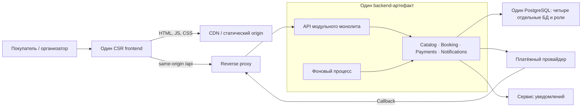

# Frontend-архитектура

Одна web-система обслуживает покупателя и организатора. Первая версия — CSR-приложение со статической доставкой через CDN, одним выпуском frontend и API модульного монолита. Документ описывает проектное решение; исполняемого frontend в репозитории пока нет.

Основания: [контекст](project-context.md), [допущения](assumptions.md), [доменная модель](domain-model.md), [жизненный цикл покупки](booking-lifecycle.md), [сценарии качества](architecture-drivers.md). Выбор структуры зафиксирован в [ADR-003](adr/ADR-003-frontend-boundaries.md), рендеринга — в [ADR-004](adr/ADR-004-rendering.md).

## Граница ответственности

Frontend отображает доступность, отправляет намерения покупателя и восстанавливает ход покупки. Booking владеет резервами, заказами, билетами и исключительностью места. Payments согласовывает одну платёжную попытку заказа с провайдером. Catalog предоставляет мероприятия и сеансы, Notifications отвечает за доставку сообщения. Правила этих модулей не переносятся в UI.

API и фоновый процесс используют один backend-артефакт. Каждый модуль обращается только к своей БД через свою роль. Между БД нет общих транзакций и прямых JOIN; согласование между модулями следует доменной модели. На схеме модули показаны как логическая граница, а не четыре независимо развёртываемых сервиса.

Отдельного BFF нет: один web-клиент обращается к API монолита через `/api`. Reverse proxy маршрутизирует запросы и завершает соединение, но не определяет доступность места или успешность оплаты. Проверка владельца заказа выполняется backend при каждом обращении; `orderId` в URL не является разрешением на чтение.

## Маршруты и ход покупки

| Маршрут | Ответственность | Данные и переход |
|---|---|---|
| `/events` | Каталог мероприятий | Публичное описание → выбор сеанса |
| `/sessions/:sessionId` | Схема зала, выбор одного места | Доступность — подсказка; команда резервирования проверяется Booking |
| `/checkout/:orderId` | Действующий резерв, сумма, начало оплаты | Заказ и `expiresAt` получены от сервера; одна платёжная попытка на заказ |
| `/orders/:orderId` | Восстановление и результат покупки | Чтение текущего статуса после обновления страницы, возврата от провайдера или потери связи |
| `/orders/:orderId/ticket` | Подтверждённый билет | Доступен только после серверного подтверждения покупки и проверки владельца |
| `/organizer` | Работа с мероприятиями и схемами залов | Backend проверяет разрешение организатора; тяжёлый редактор загружается отдельно |

Учебное ограничение первой версии — одно место в заказе. Booking создаёт резерв и связанный заказ одной транзакцией, затем допускает запрос оплаты. Нажатие на место не означает резерв, а переход на страницу результата не означает оплату. Повторный выбор после истечения создаёт новый резерв и заказ по правилам Booking, а не меняет место в истёкшем заказе.

TTL резерва — 10 минут. UI отображает время по серверному `expiresAt`, но не принимает решение о действительности резерва. Сервер проверяет `now < expiresAt` независимо от клиентского таймера и задержки фоновой очистки, которая не превышает 30 секунд после истечения. Эти правила защищают исключительность места и завершение резерва: Q-01 и Q-03.

Возврат от провайдера ведёт к чтению заказа по `orderId`. Даже параметр `success` в URL не подтверждает покупку. При неизвестном результате Payments выясняет состояние прежней попытки; UI не создаёт другую денежную операцию. Успешная оплата после истечения резерва приводит к возврату денег, а не к возрождению резерва и выпуску билета: Q-02–Q-04.

## FSD и зависимости

Предлагаемая структура показывает границы будущей реализации; пустые каталоги в репозиторий не добавлены.

| Слой | Срезы или сегменты | Содержимое |
|---|---|---|
| `app` | `routes`, `providers`, `telemetry`, `styles` | Сборка приложения, маршруты, общий контекст, подключение наблюдаемости |
| `pages` | `catalog`, `session-booking`, `checkout`, `order-status`, `ticket`, `organizer` | Композиция сценария, загрузка данных, локальные формы и состояния ошибок |
| `features` | `reserve-seat` | Повторно используемое действие выбора и резервирования: обычный вход со схемы и повторный выбор после утраты места в checkout |
| `entities` | `event-session`, `reservation`, `order`, `payment-attempt`, `ticket` | Публичные UI-модели, запросы чтения и преобразование DTO своего понятия |
| `shared` | `api`, `ui`, `config` | Транспорт, базовые элементы интерфейса и несекретная конфигурация |

Начало оплаты используется только внутри checkout и остаётся там; отдельный `features/start-payment` пока не нужен. Крупный блок не выделяется в `widgets`, если составляет практически всю единственную страницу. `processes` не используется. FSD-срез не равен backend-модулю или микросервису.

Правила зависимостей:

- Срез использует другой срез только с нижнего слоя. Внешний импорт проходит через публичную точку входа среза; глубокий импорт во внутренний файл запрещён.
- Соседние срезы не импортируют друг друга. Их координация находится на верхнем уровне: checkout связывает резерв, заказ и платёжную попытку, а не заставляет entities знать друг о друге.
- App и Shared содержат сегменты, а не предметные срезы. Shared не хранит правила TTL, оплаты или владения заказом.
- Связи между UI-моделями представлены идентификаторами. Серверные DTO преобразуются у границы API соответствующей страницы или entity; UI не разбирает сырые статусы внешнего провайдера.

Разрешённый путь: `pages/session-booking → features/reserve-seat → entities/reservation → shared/api`. Команда `reserve-seat` использует HTTP-транспорт и публичную модель резерва; остальная страница не зависит от её внутреннего запроса.

Запрещённые пути: `entities/order → pages/checkout`, `entities/order → entities/payment-attempt` и `pages/checkout → features/reserve-seat/api/request.ts`. Первый нарушает направление слоёв, второй связывает соседние срезы, третий обходит публичный API. Совместное отображение заказа и попытки выполняет страница.

Смена платёжного провайдера меняет его адаптер и подключение в Payments. При сохранении клиентского контракта Booking и frontend не меняются. Это проверяемая граница Q-05, а не обещание автоматически поддержать любые новые платёжные возможности.

## Состояние и восстановление

Локально живут выбранное до резерва место, открытая форма и состояние запроса. Сервер владеет резервом, заказом, платёжной попыткой и билетом. Кеш UI не является источником истины для покупки.

Для восстановления достаточно маршрута с `orderId`: после перезагрузки приложение заново проверяет доступ и читает состояние backend. Не сохраняется локальное утверждение «оплачено». Двойной клик блокируется интерфейсом, но корректность повтора обеспечивает серверная идемпотентность. Ключ прежнего намерения не заменяется новым при timeout; одна попытка остаётся одной попыткой.

На видимой странице незавершённого заказа статус опрашивается примерно раз в 5 секунд с jitter 4–6 секунд. В скрытой вкладке интервал не менее 30 секунд; после возвращения вкладки выполняется одно обновление. Следующий запрос начинается после завершения предыдущего, а после ошибки пауза увеличивается. Повторы чтения не создают новую платёжную команду.

Опрос прекращается после подтверждённой покупки либо завершения всего денежного процесса истёкшего/отменённого заказа: нет принятого, но ещё не обработанного намерения оплаты, нет попытки в `CREATED`, `PENDING` или `UNKNOWN`, а возврат завершён либо не требуется. Сам `EXPIRED` ещё не означает завершённость процесса. При `REVIEW_REQUIRED` UI показывает ручной разбор и оставляет обновление по запросу и при возвращении вкладки без бесконечного частого опроса. Недоступные или устаревшие сведения Payments не доказывают завершённость. Эти интервалы — проектные допущения, не замеры трафика.

| Сбой или развилка | Поведение интерфейса | Чего не происходит |
|---|---|---|
| Место занял другой покупатель | Понятный отказ, обновлённая схема, возможность выбрать другое место | Успешный резерв не рисуется оптимистически |
| Резерв истёк | Оплата недоступна; предлагается заново выбрать место | Клиентский таймер не продлевает резерв |
| Связь пропала после начала оплаты | «Проверяем результат», восстановление прежнего заказа | Не появляется новая денежная операция |
| Провайдер подтвердил оплату слишком поздно | Статус урегулирования/возврата по данным Payments | Не выпускается билет на уже освобождённое место |
| Уведомление не доставлено | Подтверждённый билет доступен в заказе; доставка рассматривается отдельно | Покупка не отменяется |
| API чтения недоступен | Последний известный статус помечен как не обновлённый; предложено повторить чтение | Старые данные не выдаются за подтверждение новой операции |
| Не загрузился route chunk | Ошибка нужного маршрута и повтор загрузки; `orderId` сохранён в URL | Не запускается оплата «ещё раз» для восстановления страницы |

## Кеширование и приватность

| Данные | Политика первой версии |
|---|---|
| HTML приложения | `Cache-Control: no-cache`: проверка версии перед повторным использованием |
| JS/CSS с хешем содержимого | Долгий кеш неизменяемого файла; старые файлы сохраняются при выпуске |
| Публичное описание каталога | До 60 секунд; без персональных полей, инвалидация при изменении публикации |
| Отображаемая доступность мест | Кеш UI не старше 5 секунд; только подсказка, резерв повторно проверяется Booking |
| Заказ, резерв, платёжный статус, билет | `Cache-Control: private, no-store`; общий CDN-кеш и Service Worker их не сохраняют |

При потере свежести схема может показываться с пометкой, но не обещает право на место. Публичная копия каталога не содержит данные конкретного покупателя. Ошибки, метрики и логи не включают билет, секреты или платёжные реквизиты; frontend передаёт технический идентификатор запроса, а доступ к серверному контексту ограничивается. Это часть защиты от раскрытия чужих данных Q-07.

## Проверка проекта и будущей реализации

| Проверка | Ожидаемый результат |
|---|---|
| Два браузера одновременно резервируют одно место | Успех только у одного; второй видит штатный отказ и актуализирует схему; базовый нагрузочный сценарий Q-01 проверяет 100 конкурентов |
| Повтор намерения и timeout оплаты | Одна платёжная попытка и не более одной операции провайдера; UI восстанавливает статус по заказу, Q-02 |
| Вкладка открыта дольше TTL, затем приходит поздний callback | Нет билета и восстановления резерва; отображается возврат, Q-03 |
| Недоступность провайдера на 5 минут | Заказ сохранён, повторного списания нет; после восстановления сверка укладывается в целевое p95 2 минуты, Q-04 |
| Замена адаптера провайдера при прежнем API | UI и Booking не меняются; ограничение изменения проверяется по зависимостям, Q-05 |
| Два владельца и общий кеш | Чужой заказ/билет недоступен, приватные ответы не попадают в общий кеш, Q-07 |

Это критерии приёмки будущей реализации. Сейчас проверяются согласованность моделей, направленность зависимостей и соответствие решений сценариям; пройденные нагрузочные или браузерные тесты не заявляются. Производительность и проверка релиза описаны в [доставке](delivery.md).
