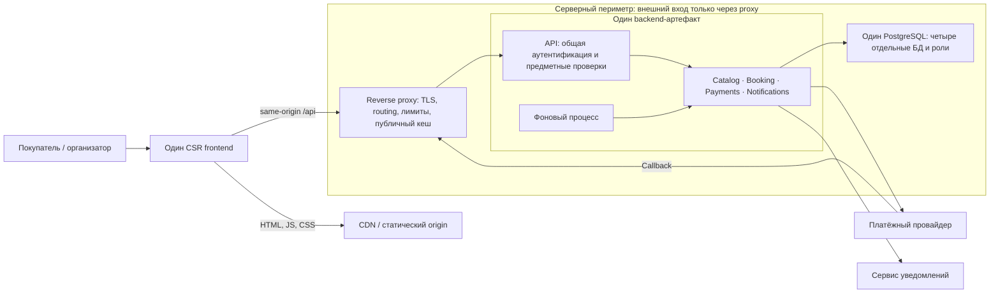

# Frontend-архитектура

Одна web-система обслуживает покупателя и организатора. Первая версия — CSR-приложение со статической доставкой через CDN, одним выпуском frontend и API модульного монолита. Документ описывает проектное решение; исполняемого frontend в репозитории пока нет.

Основания: [контекст](project-context.md), [допущения](assumptions.md), [доменная модель](domain-model.md), [жизненный цикл покупки](booking-lifecycle.md), [сценарии качества](architecture-drivers.md). Выбор структуры зафиксирован в [ADR-003](adr/ADR-003-frontend-boundaries.md), рендеринга — в [ADR-004](adr/ADR-004-rendering.md).

## Граница ответственности

Frontend отображает доступность, отправляет намерения покупателя и восстанавливает ход покупки. Booking владеет резервами, заказами, билетами и исключительностью места. Payments согласовывает одну платёжную попытку заказа с провайдером. Catalog предоставляет мероприятия и сеансы, Notifications отвечает за доставку сообщения. Правила этих модулей не переносятся в UI.

API и фоновый процесс используют один backend-артефакт. Каждый модуль обращается только к своей БД через свою роль. Между БД нет общих транзакций и прямых JOIN; согласование между модулями следует доменной модели. На схеме модули показаны как логическая граница, а не четыре независимо развёртываемых сервиса.

### Клиенты и необходимость BFF

Покупатель открывает каталог, выбирает место и восстанавливает оплату в одном web-клиенте, в том числе на мобильном браузере с ограниченной сетью. Организатор использует другой маршрут того же приложения для публикаций и схемы зала; ему нужны другие права, но не отдельный протокол или цикл выпуска. Native-клиента и партнёрского API в текущем объёме нет.

Агрегация нужна для статуса покупки: Booking возвращает свои заказ/резерв/билет и связанные сведения, прочитанные через публичный порт Payments, без доступа к чужой БД. Это общая предметная операция, а не разная сборка данных для нескольких клиентов. При недоступности Payments ответ обозначает неполноту сведений, не выдумывает успех или отказ. Отдельный BFF не добавляет необходимого контракта; цена текущего выбора — зависимость составного чтения от Payments, которую нужно ограничить ожиданием и явной деградацией.

Общих политик routing/auth/лимитов достаточно для обычного HTTP-входа; сложные клиентские политики и преобразование HTTP в иной протокол не требуются. Поэтому используются reverse proxy и общий HTTP-слой монолита, без отдельного BFF или продукта API Gateway. Решение пересматривается, если появятся отличающиеся клиентские формы данных, существенный лишний трафик/число запросов или независимые требования к протоколу и политикам. Один клиент сам по себе не исключает BFF.

| Функция | Где выполняется | Граница ответственности |
|---|---|---|
| Routing / TLS | Reverse proxy: `/api` и callback → backend API; статика → CDN/origin | API, worker и БД напрямую из интернета недоступны; proxy не решает, кому достанется место |
| Auth | Общий HTTP-слой backend проверяет аутентификацию; модуль проверяет владельца/роль при каждой операции | Публичный каталог доступен без входа; `orderId` и скрытая кнопка не дают прав. Callback проверяет адаптер Payments |
| Входные rate limits | Proxy ограничивает API по источнику и группе маршрутов; общий API-слой — авторизованные команды по пользователю и операции | При превышении `429` с `Retry-After`; квоты выбираются по проверке нагрузки. Это ограничение входа, не квота исходящих обращений worker к провайдеру |
| Cache | CDN/browser — статика; reverse proxy — только разрешённое публичное чтение Catalog | Остальные API проходят без общего кеша; условия и ключи ниже, заголовки данных определяет backend |
| Metrics | Proxy: длительность/коды/ограничения/попадания кеша; API: результат и длительность операций | Proxy не видит исход покупки по одному HTTP-коду; бизнес-результат наблюдает владелец |
| Logs / correlation | Proxy создаёт доверенный request/trace ID; API передаёт внутренний контекст вызовам | Browser получает серверный ID для диагностики; входной клиентский trace не считается доверенным и не определяет личность. Тела платежей, билеты и секреты не журналируются |

Лимиты, кеш и транспорт не заменяют доменные проверки. Защита от повторной оплаты и исключительность места остаются в Booking/Payments; одна и та же проверка владельца обязательна и при повторе команды.

## Маршруты и ход покупки

| Маршрут | Ответственность | Данные и переход |
|---|---|---|
| `/events` | Каталог мероприятий | Публичное описание → выбор сеанса |
| `/sessions/:sessionId` | Схема зала, выбор одного места | Доступность — подсказка; команда резервирования проверяется Booking |
| `/checkout/:orderId` | Действующий резерв, сумма, начало оплаты | Заказ и `expiresAt` получены от сервера; одна платёжная попытка на заказ |
| `/orders/:orderId` | Восстановление и результат покупки | Чтение текущего статуса после обновления страницы, возврата от провайдера или потери связи |
| `/orders/:orderId/ticket` | Подтверждённый билет | Доступен только после серверного подтверждения покупки и проверки владельца |
| `/organizer` | Работа с мероприятиями и схемами залов | Backend проверяет разрешение организатора; тяжёлый редактор загружается отдельно |

Учебное ограничение первой версии — одно место в заказе. Booking создаёт резерв и связанный заказ одной транзакцией, затем допускает запрос оплаты. Нажатие на место не означает резерв, а переход на страницу результата не означает оплату. Повторный выбор после истечения создаёт новый резерв и заказ по правилам Booking, а не меняет место в истёкшем заказе.

TTL резерва — 10 минут. UI отображает время по серверному `expiresAt`, но не принимает решение о действительности резерва. Сервер проверяет `now < expiresAt` независимо от клиентского таймера и задержки фоновой очистки, которая не превышает 30 секунд после истечения. Эти правила защищают исключительность места и завершение резерва: Q-01 и Q-03.

Возврат от провайдера ведёт к чтению заказа по `orderId`. Даже параметр `success` в URL не подтверждает покупку. При неизвестном результате Payments выясняет состояние прежней попытки; UI не создаёт другую денежную операцию. Успешная оплата после истечения резерва приводит к возврату денег, а не к возрождению резерва и выпуску билета: Q-02–Q-04.

## FSD и зависимости

Предлагаемая структура показывает границы будущей реализации; пустые каталоги в репозиторий не добавлены.

| Слой | Срезы или сегменты | Содержимое |
|---|---|---|
| `app` | `routes`, `providers`, `telemetry`, `styles` | Сборка приложения, маршруты, общий контекст, подключение наблюдаемости |
| `pages` | `catalog`, `session-booking`, `checkout`, `order-status`, `ticket`, `organizer` | Композиция сценария, загрузка данных, локальные формы и состояния ошибок |
| `features` | `reserve-seat` | Повторно используемое действие выбора и резервирования: обычный вход со схемы и повторный выбор после утраты места в checkout |
| `entities` | `event-session`, `reservation`, `order`, `payment-attempt`, `ticket` | Публичные UI-модели, запросы чтения и преобразование DTO своего понятия |
| `shared` | `api`, `ui`, `config` | Транспорт, базовые элементы интерфейса и несекретная конфигурация |

Начало оплаты используется только внутри checkout и остаётся там; отдельный `features/start-payment` пока не нужен. Крупный блок не выделяется в `widgets`, если составляет практически всю единственную страницу. `processes` не используется. FSD-срез не равен backend-модулю или микросервису.

Правила зависимостей:

- Срез использует другой срез только с нижнего слоя. Внешний импорт проходит через публичную точку входа среза; глубокий импорт во внутренний файл запрещён.
- Соседние срезы не импортируют друг друга. Их координация находится на верхнем уровне: checkout связывает резерв, заказ и платёжную попытку, а не заставляет entities знать друг о друге.
- App и Shared содержат сегменты, а не предметные срезы. Shared не хранит правила TTL, оплаты или владения заказом.
- Связи между UI-моделями представлены идентификаторами. Серверные DTO преобразуются у границы API соответствующей страницы или entity; UI не разбирает сырые статусы внешнего провайдера.

Разрешённый путь: `pages/session-booking → features/reserve-seat → entities/reservation → shared/api`. Команда `reserve-seat` использует HTTP-транспорт и публичную модель резерва; остальная страница не зависит от её внутреннего запроса.

Запрещённые пути: `entities/order → pages/checkout`, `entities/order → entities/payment-attempt` и `pages/checkout → features/reserve-seat/api/request.ts`. Первый нарушает направление слоёв, второй связывает соседние срезы, третий обходит публичный API. Совместное отображение заказа и попытки выполняет страница.

Смена платёжного провайдера меняет его адаптер и подключение в Payments. При сохранении клиентского контракта Booking и frontend не меняются. Это проверяемая граница Q-05, а не обещание автоматически поддержать любые новые платёжные возможности.

## Состояние и восстановление

Локально живут выбранное до резерва место, открытая форма и состояние запроса. Сервер владеет резервом, заказом, платёжной попыткой и билетом. Кеш UI не является источником истины для покупки.

После получения ответа резервирования для восстановления достаточно маршрута с `orderId`: после перезагрузки приложение заново проверяет доступ и читает состояние backend. Если первый ответ потерян и orderId ещё неизвестен, повторяется резервирование с сохранённым до отправки ключом исходной команды; [правила восстановления](interaction-model.md#повторы-ключи-и-хранение) возвращают прежний заказ. Не сохраняется локальное утверждение «оплачено». Двойной клик блокируется интерфейсом, но корректность повтора обеспечивает серверная идемпотентность. Ключ прежнего намерения не заменяется новым при timeout; одна попытка остаётся одной попыткой.

На видимой странице незавершённого заказа статус опрашивается с интервалом 4–6 секунд: базовые 5 секунд с jitter. В скрытой вкладке интервал не менее 30 секунд; после возвращения вкладки выполняется одно обновление. Следующий запрос начинается после завершения предыдущего, а после ошибки пауза увеличивается. Повторы чтения не создают новую платёжную команду.

Опрос прекращается после подтверждённой покупки либо завершения всего денежного процесса истёкшего/отменённого заказа: нет принятого, но ещё не обработанного намерения оплаты, нет попытки в `CREATED`, `PENDING` или `UNKNOWN`, а возврат завершён либо не требуется. Сам `EXPIRED` ещё не означает завершённость процесса. При `REVIEW_REQUIRED` UI показывает ручной разбор и оставляет обновление по запросу и при возвращении вкладки без бесконечного частого опроса. Недоступные или устаревшие сведения Payments не доказывают завершённость. Эти интервалы — проектные допущения, не замеры трафика.

| Сбой или развилка | Поведение интерфейса | Чего не происходит |
|---|---|---|
| Место занял другой покупатель | Понятный отказ, обновлённая схема, возможность выбрать другое место | Успешный резерв не рисуется оптимистически |
| Резерв истёк | Оплата недоступна; предлагается заново выбрать место | Клиентский таймер не продлевает резерв |
| Связь пропала после начала оплаты | «Проверяем результат», восстановление прежнего заказа | Не появляется новая денежная операция |
| Провайдер подтвердил оплату слишком поздно | Статус урегулирования/возврата по данным Payments | Не выпускается билет на уже освобождённое место |
| Уведомление не доставлено | Подтверждённый билет доступен в заказе; доставка рассматривается отдельно | Покупка не отменяется |
| API чтения недоступен | Последний известный статус помечен как не обновлённый; предложено повторить чтение | Старые данные не выдаются за подтверждение новой операции |
| Не загрузился route chunk | Ошибка нужного маршрута и повтор загрузки; `orderId` сохранён в URL | Не запускается оплата «ещё раз» для восстановления страницы |

## Кеширование и приватность

| Данные и кто видит | Точка кеша и ключ | Обновление / причина выбора |
|---|---|---|
| HTML оболочки, все пользователи | Browser и CDN; URL документа, без личных данных | `no-cache`: проверка версии перед повторным использованием; выпуск переключает HTML на новый manifest |
| JS/CSS, все пользователи | Browser и CDN; URL с content hash, вариант сжатия | `public, max-age=31536000, immutable`; новый файл получает новый URL. Старые assets сохраняются для открытых вкладок |
| Публичные описания мероприятий/сеансов | **Reverse proxy**, только allowlist анонимных GET Catalog с ответом 200; ключ: метод + origin + путь + полная каноническая query + согласованный `Vary` | `public, max-age=0, s-maxage=60, must-revalidate`. Единственный кеш данных каталога, TTL 60 секунд; CDN на `/api` и серверный кеш в Catalog не используются |
| Отображаемая доступность мест | Только краткое состояние UI по sessionId и текущему пользовательскому контексту | HTTP `private, no-store`; через 5 секунд снимок перестаёт быть свежим, следующее чтение обновляет его. После команды UI перечитывает доступность; это подсказка, не право на место |
| Заказ, резерв, платёжный статус, билет; только владелец | Не кешируются HTTP-кешами и Service Worker; UI держит лишь текущее отображение по orderId | `private, no-store`; чтение обновляет состояние, выход очищает локальное отображение. Неизвестные/устаревшие сведения помечаются, покупка не подтверждается локально |
| Черновики и данные организатора; только уполномоченный | Общего кеша нет; локальная форма не заменяет серверное состояние | `private, no-store`; после успешной записи читается актуальный результат |

Catalog фиксирует изменение публикации в своей БД. Старые ответы списка и карточек не очищаются через purge: каждый истекает по своему TTL, и следующий запрос получает заново сформированный ответ. Цена простоты — предыдущее публичное описание может выдаваться до истечения 60-секундного возраста копии. При недоступном origin просроченная копия не выдаётся как свежая: stale-while-revalidate/stale-if-error здесь не включены. Новый ответ не берётся из дополнительного серверного кеша. Если понадобится немедленно скрывать публикации, это отдельное изменение требования и политики.

UI не начинает ещё один TTL на 60 секунд после получения кешированного ответа: учитывает HTTP-возраст по `Date`/`Age` и времени доставки. По исчерпании остатка свежести видимый каталог перечитывается, а прежнее отображение до ответа помечается устаревшим; при возвращении вкладки выполняется проверка. Так TTL разных слоёв не складываются. Резервирование всегда проверяет актуальные правила Booking и не доверяет ни старой цене из каталога, ни схеме мест.

Публичный Catalog-запрос отправляется без credentials. Proxy не читает и не заполняет общий кеш для запросов с `Authorization`/`Cookie`, ответов с `Set-Cookie`, ошибок, команд или любых приватных маршрутов. Backend также не маркирует их `public`. Фильтры, страница списка и выбранное представление входят в URL; если позднее появится выбор языка/валюты, его также включают в query, а не скрывают в пользовательской cookie. UI формирует query в одном порядке; разные параметры не делят запись кеша.

**Договорённости с backend перед реализацией:**

- Catalog отдаёт только публичные поля, согласованный allowlist GET, `Date` и указанную политику `Cache-Control`; на этом этапе без ETag/Last-Modified, после TTL возвращается полное представление. Proxy при каждом cache hit выставляет актуальный `Age` и не перезаписывает `Date` временем выдачи.
- JSON-представление не меняется от пользовательских cookies; вариант сжатия учитывается через `Vary: Accept-Encoding`. Любой новый влияющий заголовок должен войти в `Vary`/ключ до включения кеша. Контракт полей и параметров проверяется совместно с frontend.
- Booking/Payments, доступность и данные организатора возвращают `private, no-store`, включая ответы ошибок и повторов. Proxy/CDN не заменяют эти заголовки; callback и команды вообще не кешируются.
- Согласованы окно публичной устарелости 60 секунд, поведение ошибок, различие описания и доступности/денежного состояния. Проверяется весь путь browser → proxy → API, а не только заголовок одного обработчика.

Ошибки, метрики и логи не включают билет, секреты или платёжные реквизиты. Для диагностики frontend использует полученный от сервера ID; доступ к серверному контексту ограничен. Это часть защиты от раскрытия чужих данных Q-07. Семантика HTTP-кеша опирается на [RFC 9111](https://www.rfc-editor.org/rfc/rfc9111.html).

## Проверка проекта и будущей реализации

| Проверка | Ожидаемый результат |
|---|---|
| Два браузера одновременно резервируют одно место | Успех только у одного; второй видит штатный отказ и актуализирует схему; базовый нагрузочный сценарий Q-01 проверяет 100 конкурентов |
| Повтор намерения и timeout оплаты | Одна платёжная попытка и не более одной операции провайдера; UI восстанавливает статус по заказу, Q-02 |
| Вкладка открыта дольше TTL, затем приходит поздний callback | Нет билета и восстановления резерва; отображается возврат, Q-03 |
| Недоступность провайдера на 5 минут | Заказ сохранён, повторного списания нет; после восстановления сверка укладывается в целевое p95 2 минуты, Q-04 |
| Замена адаптера провайдера при прежнем API | UI и Booking не меняются; ограничение изменения проверяется по зависимостям, Q-05 |
| Два владельца и общий кеш | Чужой заказ/билет недоступен; auth/cookie/Set-Cookie обходят общий кеш, приватные ответы не сохраняются, Q-07 |
| Публикация сразу после заполнения кеша каталога | После истечения исходных 60 секунд следующий запрос обновляет список/карточку; UI не добавляет свой TTL, ошибка origin не маскируется свежей копией |
| Разные фильтры и входные лимиты | Ключи каталога не смешивают представления; превышение входной квоты даёт 429/Retry-After, а повтор оплаты остаётся прежним намерением |

Это критерии приёмки будущей реализации. Сейчас проверяются согласованность моделей, направленность зависимостей и соответствие решений сценариям; пройденные нагрузочные или браузерные тесты не заявляются. Производительность и проверка релиза описаны в [доставке](delivery.md).
