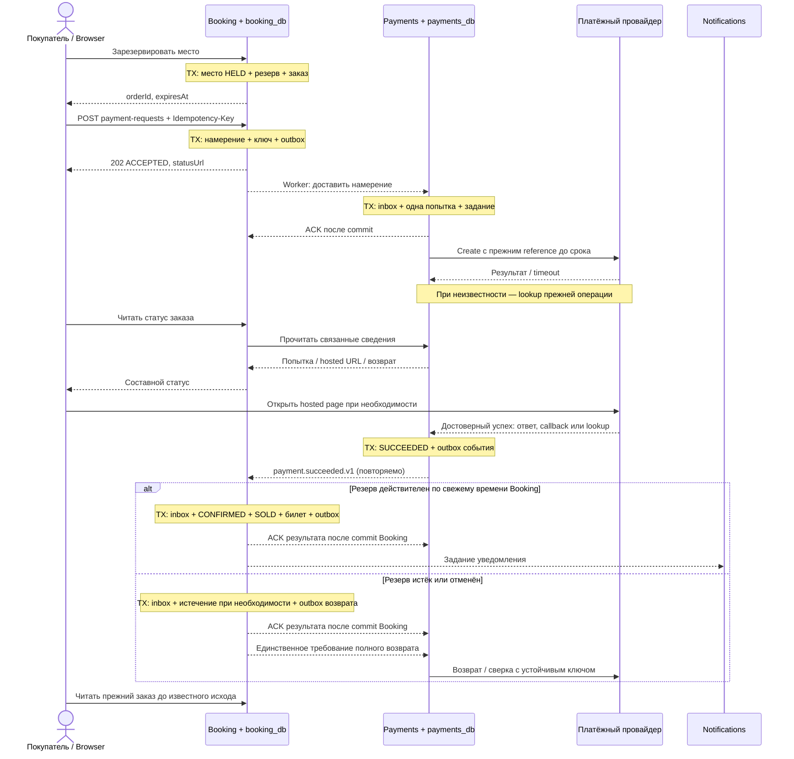

# Модель взаимодействия

Официальное ДЗ продолжает [границы домена](domain-model.md), [жизненный цикл покупки](booking-lifecycle.md) и [frontend](frontend-architecture.md). Ниже спроектированы взаимодействия; работающих обработчиков пока нет. Числа — допущения для реализации и проверки, а не результаты эксплуатации.

Booking координирует покупку, Payments — денежную операцию и её сверку. Четыре приватные БД остаются на одном PostgreSQL; API и worker используют один backend-артефакт. Взаимодействия модулей идут через публичные порты, без чтения чужих таблиц и общей транзакции.

## Все интеграции первой версии

Sync означает ожидание ответа в текущем вызове; async — сохранённую работу, продолжающуюся после него. HTTP-запрос может синхронно получить подтверждение приёма асинхронной команды. Наличие HTTP само по себе не делает весь процесс синхронным.

| Откуда → куда | Режим и данные | Почему выбран | Отказ и восстановление |
|---|---|---|---|
| Browser → CDN | Sync HTTPS: HTML и hashed assets | Нужны для открытия CSR; доменных решений здесь нет | Повтор загрузки, старые assets сохраняются при релизе; приватные API не кешируются |
| Browser → Catalog через `/api` | Sync: чтение каталога; команды организатора | Покупатель выбирает, организатор получает результат своей операции | Авторизация изменений, ограниченная старость публичных данных; публикация фиксирует снимок и outbox атомарно |
| Catalog → Booking | Async: версия опубликованного сеанса, схема и цены | Приватное владение данными; каталог не участвует в транзакции резерва | Inbox и импорт одним commit; старая версия игнорируется. Продажи открываются после импорта; после открытия структура не меняется по A-01 |
| Browser → Booking через `/api` | Sync: резерв + заказ, отмена до оплаты, чтение заказа/билета | Нужен немедленный доменный результат и проверка владельца | Конфликт места — штатный отказ; timeout не доказывает отсутствие резерва. Исходные IDs восстанавливаются по ключу reserveSeat, сохранённому до отправки |
| Browser → Booking: запрос оплаты | Sync HTTP → durable async: намерение, затем `202 ACCEPTED` | Не держим браузер и Booking-транзакцию на внешнем платеже | Повтор того же запроса; уникальность намерения по заказу действует и при разных ключах |
| Booking → Payments | Async через `PaymentPort`: намерение, order/reservation ID, сумма, валюта, expiresAt | Payments получает надёжно принятую работу независимо от HTTP-сессии | Booking outbox; Payments inbox + попытка + задание провайдеру в одной своей транзакции |
| Booking → Payments: чтение | Sync через публичный порт: попытка, ссылка на hosted page, возврат | UI получает составной статус заказа; Booking не читает payments_db | Ограниченное ожидание; при отказе сведения помечаются недоступными, а не превращаются в FAILED или подтверждённую покупку |
| Payments → провайдер | Sync HTTPS внутри фоновой работы: create, lookup, refund | Провайдер даёт результат или состояние конкретной операции | Вызов вне транзакции; timeout → сверка того же reference, не новая операция |
| Browser → hosted payment page | Sync HTTPS-навигация и действия пользователя | Карточные реквизиты принимает провайдер | Возврат на orderId лишь возобновляет чтение статуса. Query-параметр «успех» не подтверждает покупку |
| Провайдер → Payments | Async результат через HTTP callback; приём подтверждается sync | Внешняя операция может завершиться позже вызова create | Проверка подлинности, допустимого перехода и идентификаторов; commit денежного факта + outbox до ACK; при пробеле — lookup |
| Payments → Booking | Async: достоверный успех или отказ попытки | Решение о месте принимает Booking по своему текущему состоянию | Inbox + покупка/отказ/намерение возврата одной транзакцией. Формально ниже описано одно событие успеха |
| Booking → Payments: компенсация | Async: полный возврат для позднего успеха | Денежный процесс должен завершиться и после истечения заказа | Единственное задание возврата по попытке; поиск прежнего возврата, при неопределённости без гарантий — ручной разбор |
| Booking → Notifications → сервис доставки | Async задача после покупки; внешний sync HTTPS в worker | Ошибка письма не должна отменять билет | Inbox + логическая доставка; повтор с постоянным ключом, если его поддерживает провайдер; иначе внешние дубликаты возможны |

Список покрывает интеграции выбранного объёма: один web-клиент и одна hosted-оплата. Внешний IdP, BFF, брокер и независимые микрофронтенды не добавляются. API проверяет существующую аутентификацию и владельца; выбор механизма входа остаётся отдельным этапом.

## Координация и границы транзакций

Выбрана **оркестрация в Booking**: он знает исход покупки и решает, подтвердить её или потребовать компенсацию. Его durable-состояние — заказ, резерв, намерение оплаты, принятые результаты и outbox. Отдельный workflow engine для этого процесса не вводится. Payments самостоятельно восстанавливает внешний денежный эффект и не решает, кому принадлежит место.



Стрелки между модулями — логическая доставка worker через порты, а не отдельные сетевые деплои. На диаграмме показан успешный внешний платёж; достоверный отказ отдельно отменяет ожидающий заказ и освобождает только его резерв. Уведомление и возврат могут обрабатываться параллельно с последующими чтениями.

Никакой внешний вызов не удерживает блокировки места. В каждой транзакции меняются только данные одного владельца. **Inbox получателя и его бизнес-эффект фиксируются вместе**; outbox появляется вместе с исходным изменением отправителя. ACK означает commit получателя, а не успешную отправку байтов.

У брокера есть полезные возможности: независимая доставка, fan-out, управление потоком и накоплением. Здесь один артефакт и небольшая гипотетическая нагрузка A-03; durable outbox и worker достаточны. Брокер добавил бы отдельную эксплуатацию, права, схемы, повторы и восстановление, но не охватил бы транзакцией платёжный API. Выбор и условия пересмотра — [ADR-006](adr/ADR-006-durable-orchestration.md).

## Один эндпоинт

[OpenAPI 3.1.1: запрос оплаты](../contracts/payment-request.openapi.yaml) — формальное описание ровно одной операции:

```text
POST /api/v1/orders/{orderId}/payment-requests
Authorization: Bearer <opaque-token>
Idempotency-Key: <uuid одной команды>
{"reservationId":"<uuid резерва этого заказа>"}
```

Это обозначения типов, не готовые значения для отправки. Валидные иллюстративные UUID и примеры ответов находятся в OpenAPI. Сумму и валюту сервер берёт из зафиксированного заказа. Доверенный hosted URL позднее возвращается при чтении статуса; клиент не задаёт платёжного получателя или callback URL.

Алгоритм приёма:

1. Проверить формат, аутентификацию и владельца при каждом запросе, включая replay. Чужой и отсутствующий заказ дают одинаковый `404`; ошибочный ввод — `400`.
2. Найти запись ключа в области `buyerId + requestOrderPayment + hash(key)`. Отпечаток включает метод, путь и каноническое тело. Повтор с другим отпечатком — `409 IDEMPOTENCY_KEY_REUSED`.
3. Сериализовать конкурирующие изменения заказа. Если намерение уже принято, сопоставить reservationId и восстановить его исходный `202`. Это работает и с новым HTTP-ключом: уникальность по orderId запрещает вторую попытку.
4. Только для нового намерения проверить состояние и свежее время БД после блокировки. При `now >= expiresAt` — `409 RESERVATION_EXPIRED`. Отмена и приём оплаты используют ту же сериализацию; после приёма пользовательская отмена недоступна.
5. Одной Booking-транзакцией записать намерение, ключ/отпечаток/ответ и outbox. Уникальные ограничения защищают и параллельные ключи, и один ключ, одновременно применённый к разным заказам. При конфликте проигравшая транзакция откатывается и перечитывает сохранённый результат.
6. После commit вернуть `202` с `paymentRequestId`, `orderId`, `status: ACCEPTED`, `statusUrl`. Это ID намерения Booking, не попытки Payments. `Location` совпадает с statusUrl. Повтор воспроизводит приём, даже если заказ уже истёк или подтверждён; текущий результат читается отдельно.

Все ответы имеют `Cache-Control: private, no-store`. `429` и `503` содержат `Retry-After`; при потере ответа клиент повторяет прежнюю команду после backoff. Ни `503`, ни timeout не доказывают rollback. Валидационные и доменные `4xx` не повторяются автоматически с неизменённым ошибочным вводом.

API чтения не формализован вторым контрактом в этом ДЗ, но его обязанность определена: проверка владельца, состояние заказа/резерва/билета, принятого намерения, попытки и возврата, признак свежести сведений Payments. Отсутствие ответа Payments не равно отсутствию попытки и не переводит её в бизнес-состояние `UNKNOWN`. Правила UI — в [frontend-архитектуре](frontend-architecture.md#состояние-и-восстановление).

## Одно событие

[JSON Schema 2020-12: payment.succeeded.v1](../contracts/payment-succeeded.v1.schema.json) описывает подтверждённый **денежный факт**, который Payments записывает вместе с outbox. Событие содержит обязательные eventId, paymentRequestId, paymentAttemptId, orderId, providerPaymentId, amountMinor, currency, schemaVersion, paymentVersion и occurredAt. Необязательный providerOccurredAt нужен только для сверки.

`schemaVersion = 1` и имя события задают формат; `paymentVersion` монотонно растёт внутри попытки; eventId постоянен у одной outbox-записи при повторах. Эти три понятия не взаимозаменяемы. occurredAt — время записи факта Payments, а не разрешение приобрести место задним числом.

Получатель Booking:

1. Проверяет версию, схему и доверенный источник. UUID и корректный JSON не являются аутентификацией. Модульный порт доступен внутреннему worker; внешние callback принимает только адаптер Payments.
2. В одной транзакции проверяет inbox и соответствие намерения, заказа, попытки, суммы и валюты. Первое достоверное событие связывает попытку с намерением; другая попытка для того же намерения — конфликт для разбора. Чужие/несопоставимые факты не подтверждают покупку.
3. Блокирует заказ, резерв и место в согласованном порядке; читает свежее время БД. Если резерв ещё действителен, фиксирует покупку, билет, inbox и outbox уведомления вместе.
4. Если срок наступил, сам завершает ещё активный резерв и заказ, освобождает только собственное удержание и сохраняет единственное требование возврата вместе с inbox. Если место уже у другого резерва, оно не меняется. Раннее время провайдера не возрождает истёкшее право.
5. После commit подтверждает обработку. Повтор с другим eventId, но тем же денежным фактом также безопасен: уникальны результат попытки, билет по заказу и компенсация по попытке. Несовместимые данные для уже известного факта отправляются на разбор.

Отсутствующая промежуточная версия не заставляет ждать все старые `PENDING`: достоверный `SUCCEEDED` допускается напрямую. Старые промежуточные состояния не откатывают терминальное. Противоречие денежных результатов требует сверки Payments с провайдером, не выбора по времени доставки. Гарантия порядка брокера для этого не нужна.

## Повторы, ключи и хранение

| Опасный повтор | Устойчивая идентичность | Где и что фиксируется атомарно |
|---|---|---|
| Потеря первого ответа reserve + order | buyerId + reserveSeat + clientKey; отпечаток sessionId и seatId | Booking: ключ, резерв, заказ и исходный ответ одной транзакцией. Replay возвращает прежние IDs даже после TTL, не создавая новый резерв; другой payload — конфликт |
| Два нажатия, timeout, новый HTTP-ключ | Область ключа + отпечаток; дополнительно уникальный orderId намерения | Booking: ключ, исходный 202, намерение, outbox |
| Повтор доставки намерения | ID команды/намерения + уникальный orderId попытки | Payments: inbox, попытка, внешний reference и задание |
| Worker упал вокруг create | Постоянный merchant reference попытки | Payments сохраняет намерение внешнего вызова до отправки; внешнюю единственность обеспечивает A-05, не локальная транзакция |
| Дубликат callback / lookup | ID операции провайдера в области адаптера + попытка | Payments: допустимый переход, новая версия и один outbox денежного факта |
| Повтор успеха до/после ACK | eventId и семантическая связка намерение/попытка/заказ | Booking: inbox, один билет либо одно намерение возврата, outbox |
| Повтор компенсации | paymentAttemptId + полный возврат; отдельный refund reference | Payments: inbox и единственный возврат; внешний эффект требует тех же гарантий поиска/идемпотентности |
| Повтор уведомления | orderId + тип подтверждения | Notifications: inbox и одна логическая доставка; внешняя дедупликация зависит от сервиса |
| Старый снимок каталога | sessionId + версия публикации | Booking: inbox + импорт; проданные/занятые места и сумма заказа не сбрасываются |

Перед первым резервированием Browser сохраняет clientKey и выбранные sessionId/seatId в локальном хранилище текущего пользовательского сценария. Это позволяет повторить исходный запрос после перезагрузки, когда orderId ещё неизвестен. После получения ответа восстанавливается уже маршрут заказа. При выходе локальная запись очищается; повтор на сервере всегда проверяет аутентифицированного владельца. Ключ не даёт доступа к заказу сам по себе. Новый осознанный выбор после известного отказа/истечения — новая команда с новым ключом; сетевой timeout таким выбором не считается.

Для первой версии автоматическое удаление ключей, привязок денежных операций и inbox не вводится: они сохраняются на срок жизни заказа и урегулирования. Это явная цена хранения. До появления политики архивирования нужны оценка объёма и сохранение уникальных бизнес-ссылок/отпечатков для позднего replay; удалённый payload не должен открывать возможность новой оплаты старого orderId. Идентификаторы заказов не переиспользуются.

**24 часа в A-05 — минимальное предполагаемое окно провайдера**, а не срок, после которого можно забыть внутреннюю попытку. Гарантии конкретного провайдера ещё нужно проверить. Время первой возможной отправки и reference сохраняются до внешнего вызова. После гарантированного окна запрещён повтор create, остаётся lookup/разбор. Полный возврат использует собственный постоянный ключ и поиск; неизвестный результат без действующих гарантий → `REVIEW_REQUIRED`, без второго автоматического refund.

## Доставка и восстановление

Worker забирает due-задание короткой транзакцией с ограниченной арендой, отпускает блокировки и вызывает порт/провайдера. После падения аренда истекает, задание доступно снова. Повторный worker использует ту же идентичность; просроченный владелец аренды не затирает результат нового. Сериализация переходов и запрет регрессии состояния нужны даже при наличии аренды.

Проектные исходные настройки: локальное чтение Payments ограничить 300 мс, внешний запрос — 5 с, аренду — 30 с; сетевой вызов завершается раньше аренды. При превышении не держать HTTP покупателя. Retry с jitter, исходная задержка 1 с, удвоение до потолка 30 с; соблюдать больший Retry-After и лимит провайдера. Эти настройки проверяются на профиле Q-04 и уточняются по фактическому адаптеру. Общая квота ограничивает все workers, а не каждый процесс отдельно.

Сохраняются число попыток, nextAttemptAt, последняя классифицированная ошибка и статус обработки. Временная недоступность не уничтожает задание после произвольных N повторов. Неизвестная версия, невалидное сообщение или несопоставимый денежный факт сохраняются в карантине с причиной и требуют разбора; они не блокируют весь поток. Исправленная повторная доставка сохраняет прежнюю бизнес-идентичность. Некорректное сообщение нельзя отметить как успешно применённое.

До первого create Payments проверяет expiresAt. Если отправки точно не было, просроченное задание завершается `FAILED: reservation_expired_before_submit` и сообщает отказ Booking. Если отправка могла произойти, истечение не отменяет сверку: lookup либо безопасный повтор с прежним ключом в гарантированном окне. После установления успеха Booking повторно решает вопрос срока и компенсации.

Наблюдаем возраст недоставленного outbox, количество UNKNOWN/карантина/возвратов на разборе, ошибки и длительность обработки по версии. Логи не содержат bearer-токен, исходный Idempotency-Key, реквизиты и содержимое билета. Связанные технические ID доступны ограниченно. [Риски, SLI/SLO и карта деградации](quality-and-operations.md) определяют реакции; процесс не считается завершённым лишь потому, что HTTP вернул 202.

## Совместимость и проверка

Запрос v1 закрыт для неизвестных полей. Ответы и событие допускают добавочные поля; потребители игнорируют неизвестные поля, сохраняя проверку обязательных значений. Изменение смысла, удаление поля, новый обязательный ввод или несовместимый enum требуют новой версии. При миграции событие v2 доставляется после готовности потребителя; временная двойная доставка всё равно защищается бизнес-ключом, а не разными eventId.

Формальные схемы проверяют структуру, но не обеспечивают аутентификацию, уникальность, атомарность или корректность денег. Сценарии будущей приёмки — в [жизненном цикле](booking-lifecycle.md#сценарии-будущей-приёмки). Критические проверки: crash после каждого commit/до ACK, внешнее списание с потерянным ответом, конкурентные разные ключи и успех на границе TTL. Нагрузочные результаты не заявлены.

Основание: уроки 14–15, [критерии и таймкоды ДЗ](homework/04-interaction.md#источники). Используемый формат: [OpenAPI 3.1.1](https://spec.openapis.org/oas/v3.1.1.html).
