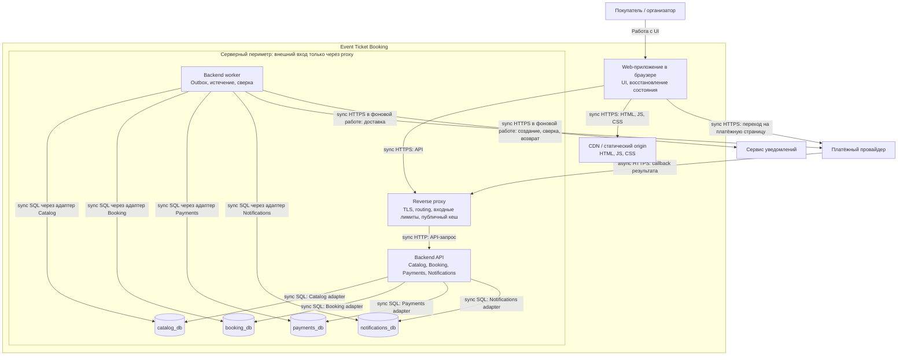

# C4 Containers: первая поставка

Представление проектируемых исполняемых частей, не список уже развёрнутых систем. Внешние участники — в [C4 Context](system-context.md); доменные границы — на [Context Map](domain-model.md).

Режим подписан у каждой связи схемы: `sync` означает ожидание ответа в текущем вызове, `async` — доставку, продолжающуюся после него. Проектные пределы ожидания и поведение при их исчерпании:

| Связь | Режим | Предел и поведение при таймауте |
|---|---|---|
| Browser → CDN и статический origin | sync | Повтор загрузки; при недоступном chunk маршрут сообщает об ошибке, `orderId` сохраняется в URL |
| Browser → reverse proxy (`/api`) | sync | Клиент получает неизвестность, а не отказ; повтор той же команды безопасен по её ключу |
| Reverse proxy → Backend API | sync | Ошибка отдаётся как `503` с `Retry-After`; ни таймаут, ни `503` не доказывают отката операции |
| API → публичный порт Payments (чтение статуса) | sync | 300 мс: сведения помечаются недоступными, состояние не превращается в `FAILED` или подтверждённую покупку |
| API или worker → БД своего владельца | sync | Подтверждённый rollback отменяет локальный эффект. Потеря ответа на COMMIT оставляет результат неизвестным: перечитать / повторить прежнюю команду с той же идентичностью; принятое ранее задание остаётся в outbox |
| Worker → платёжный провайдер | sync внутри долговечной работы | 5 с при аренде задания 30 с: таймаут не означает отсутствие операции, используется тот же reference для сверки, новая денежная операция не создаётся |
| Провайдер → proxy (callback) | async | Повторная доставка ожидаема и распознаётся по идентификатору операции; пропущенный callback компенсируется сверкой |
| Worker → сервис уведомлений | sync внутри долговечной работы | Задание остаётся и повторяется с backoff; недоставленное уведомление не отменяет подтверждённую покупку |
| Browser → платёжная страница провайдера | sync | Возврат к маршруту заказа: состояние перечитывается у сервера, вторая оплата не создаётся |

Числа — те же проектные настройки, что в [модели взаимодействия](interaction-model.md#доставка-и-восстановление); измеренными они не являются. Общие пределы API/proxy и внутренние доли описаны в [бюджете времени](reliability.md#бюджет-времени-и-повторы).

API и worker — два режима запуска одного артефакта с общей версией доменных контрактов. Worker обращается к данным через код владельцев; схема не разрешает произвольные межмодульные SQL. Четыре базы могут жить на одном PostgreSQL instance с четырьмя ролями; их отказ будет коррелированным. Независимых релизов логических сервисов пока нет.

API обрабатывает короткие команды и callback; долгие внешние операции выполняются worker после долговечной постановки работы. Booking принимает намерение начать оплату и outbox в своей транзакции; запрос UI означает приём этого намерения, а не создание внешнего платежа. Доставщик outbox вызывает порт Payments, который фиксирует inbox и попытку в своей БД. Так синхронный внутренний вызов при доставке реализует асинхронный долговечный процесс без ожидания банка в HTTP-запросе покупателя.

Только Booking соединяет резерв, заказ и билет своей транзакцией. Другие БД фиксируют свою работу и очередь, доставка между ними повторяема. При недоступности Booking резерв не принимается; UI сообщает об ошибке/неизвестности и перечитывает прежнюю операцию.

Выбрана одна CSR-сборка через CDN, API обслуживает тот же origin. CDN кеширует статику; отдельный 60-секундный кеш публичного Catalog GET находится в reverse proxy, приватные API его обходят. Общая аутентификация выполняется HTTP-слоем backend, проверка владельца — модулем. Прямого внешнего входа к API, worker или БД нет; callback также проходит через proxy. [Frontend-архитектура](frontend-architecture.md) раскрывает FSD и пользовательский путь, [доставка](delivery.md) — splitting, окружения и откат. SSR, Kubernetes, отдельный BFF и брокер в первую поставку не включены.
