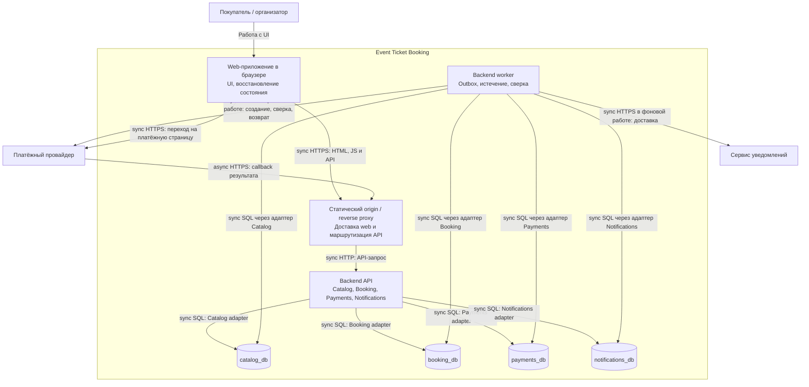

# C4 Containers: первая поставка

Представление проектируемых исполняемых частей, не список уже развёрнутых систем. Внешние участники — в [C4 Context](system-context.md); доменные границы — на [Context Map](domain-model.md).

Режим подписан у каждой связи схемы: `sync` означает ожидание ответа в текущем вызове, `async` — доставку, продолжающуюся после него. Поведение при исчерпании ожидания:

| Связь | Режим | При таймауте |
|---|---|---|
| Browser → статика и `/api` | sync | Повтор загрузки или запроса; приватные ответы не берутся из кеша, отсутствие ответа не считается отказом домена |
| Reverse proxy → Backend API | sync | Клиент получает неизвестность, а не отказ; повтор той же команды безопасен по её ключу |
| API или worker → БД своего владельца | sync | Транзакция откатывается целиком; принятое ранее задание остаётся в outbox и повторяется |
| Worker → платёжный провайдер | sync внутри долговечной работы | Таймаут не означает отсутствие операции: используется тот же reference для сверки, новая денежная операция не создаётся |
| Провайдер → proxy (callback) | async | Повторная доставка ожидаема и распознаётся по идентификатору операции; пропущенный callback компенсируется сверкой |
| Worker → сервис уведомлений | sync внутри долговечной работы | Задание остаётся и повторяется; недоставленное уведомление не отменяет подтверждённую покупку |
| Browser → платёжная страница провайдера | sync | Возврат к маршруту заказа: состояние перечитывается у сервера, вторая оплата не создаётся |

API и worker — два режима запуска одного артефакта с общей версией доменных контрактов. Worker обращается к данным через код владельцев; схема не разрешает произвольные межмодульные SQL. Четыре базы могут жить на одном PostgreSQL instance с четырьмя ролями; их отказ будет коррелированным. Независимых релизов логических сервисов пока нет.

API обрабатывает короткие команды и callback; долгие внешние операции выполняются worker после долговечной постановки работы. Booking принимает намерение начать оплату и outbox в своей транзакции; запрос UI означает приём этого намерения, а не создание внешнего платежа. Доставщик outbox вызывает порт Payments, который фиксирует inbox и попытку в своей БД. Так синхронный внутренний вызов при доставке реализует асинхронный долговечный процесс без ожидания банка в HTTP-запросе покупателя.

Только Booking соединяет резерв, заказ и билет своей транзакцией. Другие БД фиксируют свою работу и очередь, доставка между ними повторяема. При недоступности Booking резерв не принимается; UI сообщает об ошибке/неизвестности и перечитывает прежнюю операцию.

Рендеринг, splitting и доставка раскрываются frontend-работой. Эта схема не требует SSR, Kubernetes, отдельного BFF или брокера.
