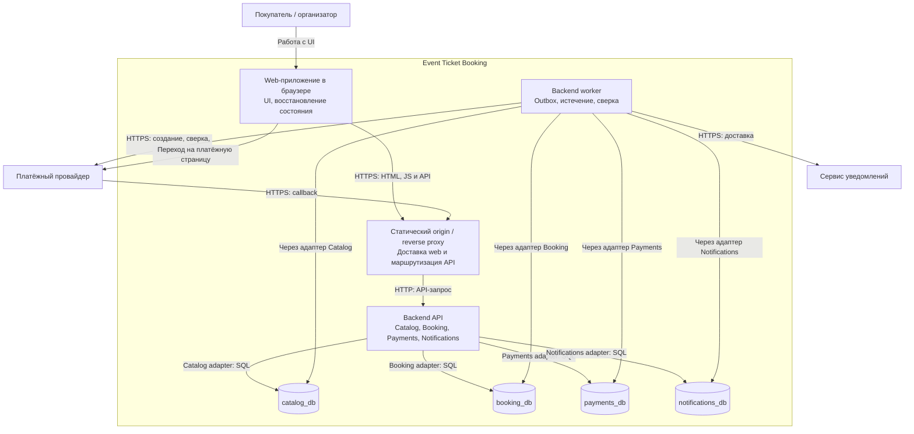

# C4 Containers: первая поставка

Представление проектируемых исполняемых частей, не список уже развёрнутых систем. Внешние участники — в [C4 Context](system-context.md); доменные границы — на [Context Map](domain-model.md).

API и worker — два режима запуска одного артефакта с общей версией доменных контрактов. Worker обращается к данным через код владельцев; схема не разрешает произвольные межмодульные SQL. Четыре базы могут жить на одном PostgreSQL instance с четырьмя ролями; их отказ будет коррелированным. Независимых релизов логических сервисов пока нет.

API обрабатывает короткие команды и callback; долгие внешние операции выполняются worker после долговечной постановки работы. Booking принимает намерение начать оплату и outbox в своей транзакции; запрос UI означает приём этого намерения, а не создание внешнего платежа. Доставщик outbox вызывает порт Payments, который фиксирует inbox и попытку в своей БД. Так синхронный внутренний вызов при доставке реализует асинхронный долговечный процесс без ожидания банка в HTTP-запросе покупателя.

Только Booking соединяет резерв, заказ и билет своей транзакцией. Другие БД фиксируют свою работу и очередь, доставка между ними повторяема. При недоступности Booking резерв не принимается; UI сообщает об ошибке/неизвестности и перечитывает прежнюю операцию.

Рендеринг, splitting и доставка раскрываются frontend-работой. Эта схема не требует SSR, Kubernetes, отдельного BFF или брокера.
