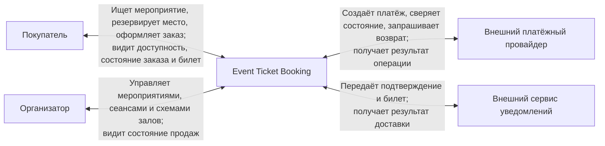

# Системный контекст

Диаграмма показывает границу проектируемой системы и внешние зависимости. Внутренняя декомпозиция описана в [доменной модели](domain-model.md), исполняемые части — в [C4 Containers](system-containers.md).

## Ответственность системы

- управлять мероприятиями, сеансами и доступностью мест;
- создавать и завершать временные резервы;
- вести жизненный цикл заказа;
- регистрировать платёжные попытки и согласовывать результат с провайдером;
- выпускать электронный билет;
- инициировать уведомление и хранить состояние доставки.

## Внешние ответственности

Платёжный провайдер принимает платёжные реквизиты и выполняет денежную операцию. Event Ticket Booking не хранит данные банковской карты.

Сервис уведомлений отвечает за физическую доставку сообщения. Его недоступность не влияет на сохранность заказа или билета.
